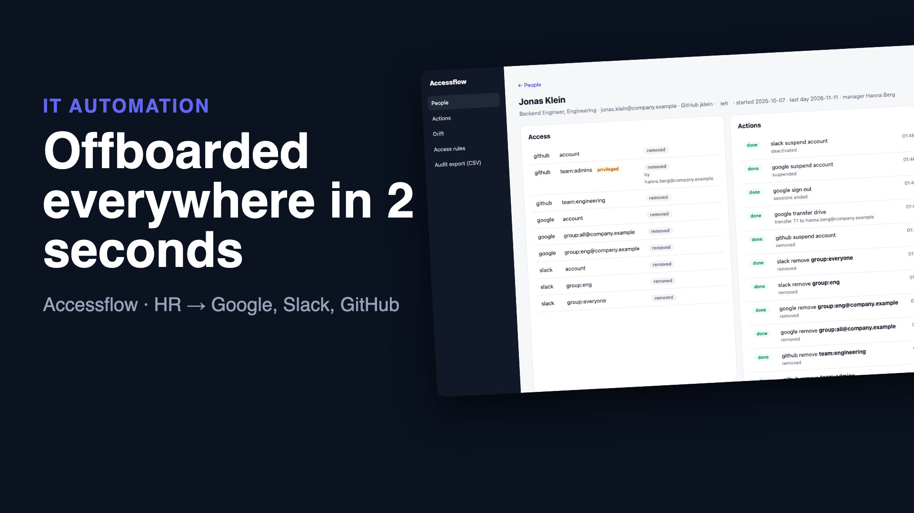
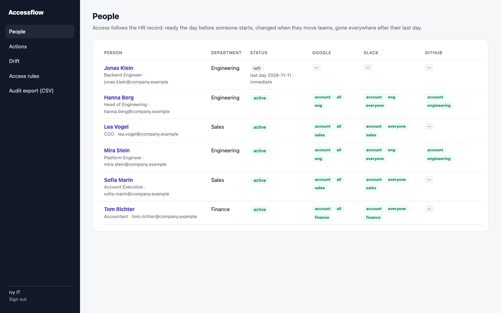
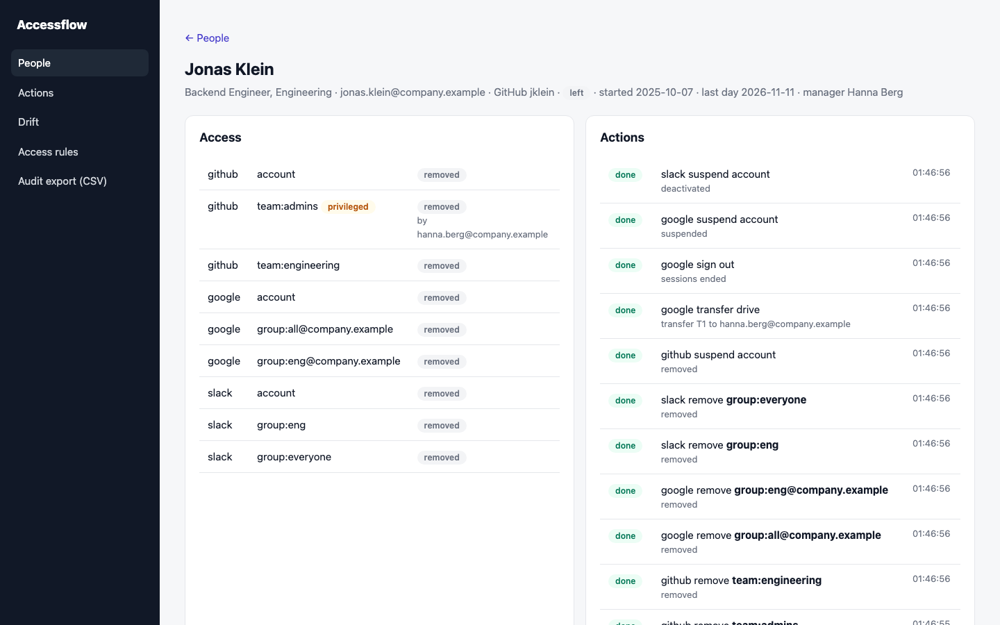

# Accessflow: access that follows the HR record

When someone joins, IT creates their accounts. When they move teams, someone is supposed to change their groups. When they leave, someone is supposed to remove *everything*. That last one is where the risk is: a forgotten Slack account, a GitHub admin from two years ago, a Drive full of company files nobody can reach.

Accessflow treats access like infrastructure as code. The HR system says who should have what. Accessflow makes Google Workspace, Slack and GitHub match, keeps a record of every change, and reports anything nobody planned.

```
 HR system ─ signed webhooks (+ poll as a safety net) ─▶ desired access per person ─▶ plan the difference ─▶ actions with retries
   hired / moved / last day / immediate termination        (department rules,            create, add, remove,     Google Admin SDK
                                                            approved privileged access)  transfer Drive, sign out  Slack SCIM · GitHub
 managers ─ Slack DM with a signed link ─▶ approve privileged access          drift scan ─▶ accounts nobody planned, unapproved admins
```

**▶ [Watch the 58-second demo](docs/demo.mp4)**: a real recording of the running stack, made with [`demo/record.py`](demo/record.py) (Playwright) and [`demo/video`](demo/video) (Remotion).

[](docs/demo.mp4)

| Everyone's access at a glance | A leaver, removed everywhere |
|---|---|
|  |  |

## Run it

```bash
./setup.sh                      # writes .env with random secrets
docker compose up --build       # panel on http://127.0.0.1:8110 (local demo login: it@example.com / password)
```

The `apis` service is a **local stand-in** for an HR system and for Google Workspace, Slack and GitHub, with their real request shapes:
- **Google:** the Admin SDK Directory and Data Transfer APIs
- **Slack:** SCIM v2 Users and Groups, plus the Web API for DMs
- **GitHub:** organization and team memberships

For real use, point the URLs and tokens at your tenant: a Google service account with domain-wide delegation, a Slack SCIM token (Business+ or Enterprise Grid), and a GitHub App installation token.

## How it decides

- **The HR record is the source of truth.** Changes arrive as signed webhooks (`X-HRIS-Signature`, de-duplicated by event ID). A periodic poll catches anything a webhook missed. Every field change that matters is written to the audit log with before and after.
- **Desired state, then a plan.**
  - Each person's access follows from department rules:
    - nothing until **the day before** their start date
    - their department's access while employed
    - nothing after their **last day**, or right away for an **immediate termination**
  - The planner compares that with what's been granted and queues only the difference.
  - Moving from Finance to Sales adds the Sales groups and removes the Finance ones.
- **Leavers are handled completely.** Groups are removed first and accounts suspended last. Google sessions are ended and Drive ownership is transferred to the manager. Admin rights go too. In the end-to-end test, an immediate termination was fully done in **2.1 seconds**.
- **Every action is idempotent.** "Add" when already there and "remove" when already gone both count as success, and Slack lookups go by `userName` before anything is created. So a retry after a timeout can't fail on its own earlier half-success.
- **Order is kept, outages are retried.** Within one system a person's steps run in order: the account before its groups. A failing step blocks the later ones and retries with backoff. A refused one fails visibly with the API's answer and a Retry button.
- **Privileged access is never derived.** GitHub admins and Google admin are requested by IT, and only the person's **manager** can approve them. The approval comes through a Slack DM with a link signed for that one request and that one manager, so IT can't approve its own requests.
- **Drift.** A scan lists the accounts in each system and flags:
  - any active account with no current employee behind it
  - anyone in the GitHub admins team without an approval

  Service accounts (`svc-…`, `…-bot`) are ignored. Each finding can be removed with one click, or accepted as a known exception, and either choice is audited.
- **Audit export.** `/audit.csv` has every HR change, plan, action, approval and drift decision with a timestamp, ready for a SOC 2 or ISO 27001 access review.

## Verified end to end

`./e2e.sh` runs the stack in Docker; HR changes go through the HR stand-in's signed webhooks:

```
PASS existing staff: 5 people from the HR system got Google, Slack and (engineers) GitHub, with their department's groups
PASS joiner: hired in the HR system, accounts and groups in all three systems; Slack's outage retried
PASS mover: Finance → Sales moved the groups in Google and Slack
PASS privileged access: requested by IT, nothing granted until the manager approved from a Slack DM
PASS leaver: immediate termination removed everything in 2.1s, admin rights included; Drive to the manager, sessions ended
PASS drift: a contractor's leftover admin access and a stray Slack account found by the scan and removed
PASS audit: forged HR webhook refused; the CSV export has every change, approval and removal
```

## Tests

```bash
uv sync && uv run pytest -q      # 9 tests
```

**Covered:**
- department access for existing staff
- joiners only from the day before they start
- movers, leavers (Drive transfer, sign-out), and the last day still working
- outages with step order kept
- manager-only approvals
- drift with service accounts ignored and fixes noticed
- webhook signatures and duplicates
- the approval link, the audit export and the panel

## Not included yet

- More systems (Microsoft 365 / Entra ID, Atlassian, 1Password, Notion). Each is one client class with the same five operations.
- Scheduled access reviews, where managers re-confirm their team's privileged access every quarter
- Pre-start equipment and onboarding checklists

## Stack

Python 3.12 · FastAPI · SQLite (WAL) · Google Admin SDK · Slack SCIM v2 · GitHub REST · httpx · Docker · GitHub Actions
