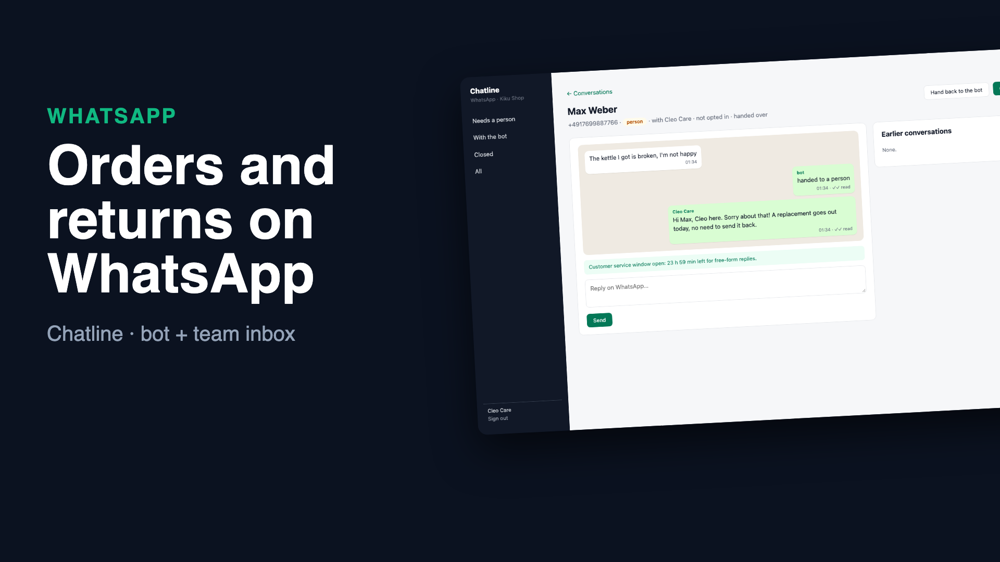
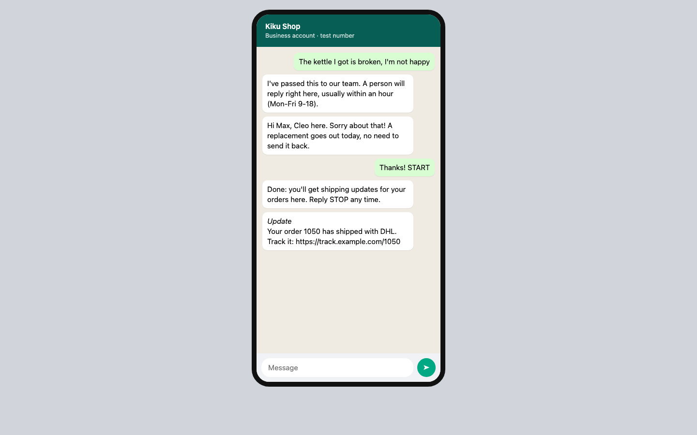
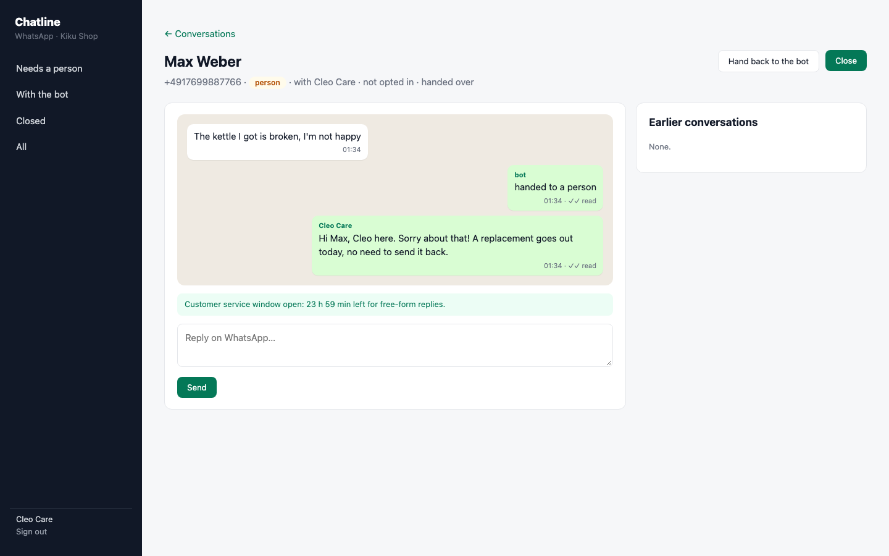

# Chatline: WhatsApp customer service that knows when to hand over

Most WhatsApp questions a shop gets are "where is my order?" and "how do I send this back?". Chatline answers those two with buttons and lists, so customers tap instead of type. Everything else goes to a person in a team inbox. It also follows WhatsApp's rules, which trip up most first attempts:
- the 24-hour customer service window
- approved templates
- opt-in
- signed, retried webhooks

```
 customer's WhatsApp ─▶ Cloud API webhook (signed, retried) ─▶ de-duplicate ─▶ person has it? ── yes ─▶ team inbox
                                                                                   │ no
                                                        track an order / register a return (buttons + lists)
                                                        anything else or not understood twice ─▶ hand to a person
 shop: "order shipped" ─▶ opted in? ─▶ approved template (works outside the 24-hour window)
```

**▶ [Watch the 65-second demo](docs/demo.mp4)**: a real recording of the running stack, made with [`demo/record.py`](demo/record.py) (Playwright) and [`demo/video`](demo/video) (Remotion). Every tap on the phone is a real signed webhook to the app.

[](docs/demo.mp4)

| The customer's side | The team inbox |
|---|---|
|  |  |

## Run it

```bash
./setup.sh                      # writes .env with random secrets
docker compose up --build       # team inbox http://127.0.0.1:8108 (local demo login: care@example.com / password)
```

A customer's phone is at `http://127.0.0.1:8109/phone/4917612345678?token=<FAKES_ADMIN_TOKEN>`: type or tap there.

The `apis` service is a **local stand-in** for the WhatsApp Cloud API and a shop. It enforces what the real API enforces:
- error `131047` outside the 24-hour window
- `132001` for unapproved templates
- the button limits

It also signs its webhooks with `X-Hub-Signature-256`. For real use:
1. Point `GRAPH_URL` at `https://graph.facebook.com` with a System User token and your phone number ID.
2. Set `<PUBLIC_URL>/webhooks/whatsapp` and `WA_VERIFY_TOKEN` in the Meta app's webhook settings.
3. Point `SHOP_URL` at your shop's API.

## How it decides

- **Buttons and lists, not guessing.**
  - The menu is three reply buttons; orders and items are list messages, within WhatsApp's limits (3 buttons, 20-character titles, 24-character rows).
  - Free text is matched for the common intents in English and German: "where is my order", "wo ist mein Paket", "retoure", "complain", "kaputt".
  - Two messages in a row it doesn't understand go to a person rather than a third "sorry, I didn't get that".
- **Order details only for the owner.** Orders are found by the customer's WhatsApp number. Someone asking about an order number that isn't theirs must confirm its postcode; two wrong answers and a person takes over.
- **Returns end to end.**
  - Only orders delivered in the last 30 days are offered.
  - The return is registered with the shop using an `Idempotency-Key`, so a double tap makes one return, not two.
  - The label link comes back in the chat.
- **The bot stays quiet while a person has the conversation.** The inbox shows "needs a person" first, with unread counts. Agents can take over, hand back to the bot, or close.
- **WhatsApp's 24-hour window.** Free-form replies are refused *before* calling the API once the customer's last message is over 24 hours old. The inbox then offers the approved template instead.
- **Opt-in for updates.** "Order shipped" templates go only to customers who opted in (`START`), and `STOP` ends them. Keywords count only in short messages: "Thanks! START" opts in; "please don't stop the delivery" doesn't opt out.
- **Webhooks are verified and idempotent.**
  - **Signatures:** `X-Hub-Signature-256` is checked against the app secret.
  - **Retries:** Meta retries deliveries, so inbound messages are de-duplicated by message ID.
  - **Handshake:** the subscription handshake echoes the challenge only for the right verify token.
- **Delivery ticks that are right.** Statuses only move forward: a late "delivered" never overwrites "read". They're also kept when they arrive *before* our own record of the message is written. The end-to-end test caught exactly that race: the API answers the send call after it has already posted "delivered".

## Verified end to end

`./e2e.sh` runs the stack in Docker. The customers are driven through the Cloud API stand-in and the team through the inbox:

```
PASS handshake: Meta's webhook verification answered with the challenge
PASS tracking: free text understood, the customer's two orders offered as a list, tracking link sent
PASS returns: order, item and reason picked by tapping; return registered with a label; the redelivered webhook was ignored
PASS handoff: complaint passed to a person, bot silent meanwhile, the agent's reply delivered and read
PASS 24-hour rule: 30 hours after the customer's message the inbox offers templates only
PASS updates: shipping template sent only after the customer opted in with START
PASS security: a forged webhook was refused
```

## Tests

```bash
uv sync && uv run pytest -q      # 8 tests
```

**Covered:**
- the menu, lists and free text
- the postcode check
- returns with idempotency and the 30-day rule
- handoff and closing
- the window, templates and opt-in/out
- signatures, the handshake, duplicates
- out-of-order and early statuses
- the message builders' limits
- the inbox

## Not included yet

- Media messages: photos of damaged items are stored as `[image]` and left to a person
- An LLM for free-text questions. The intent rules are the plug-in point; [Support Desk](../support-desk) shows the doc-grounded drafting this would reuse
- Business hours and away messages per team, CSAT after closing

## Stack

Python 3.12 · FastAPI · SQLite (WAL) · WhatsApp Cloud API · httpx · Jinja2 · Docker · GitHub Actions
