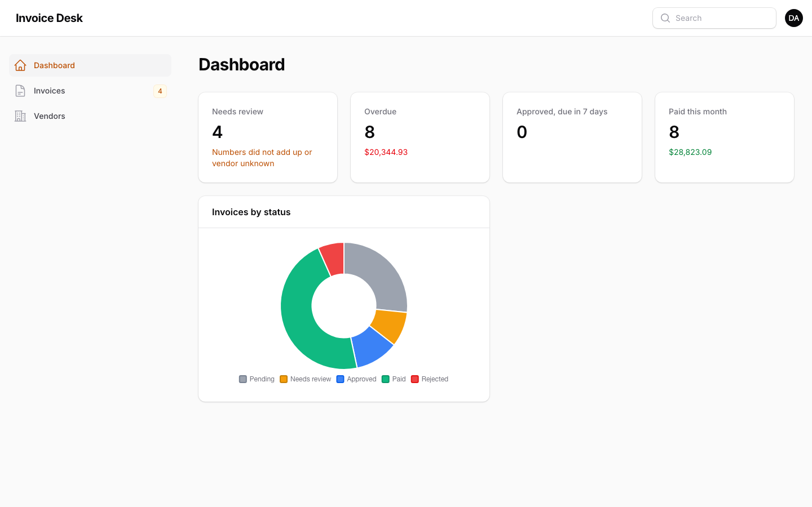
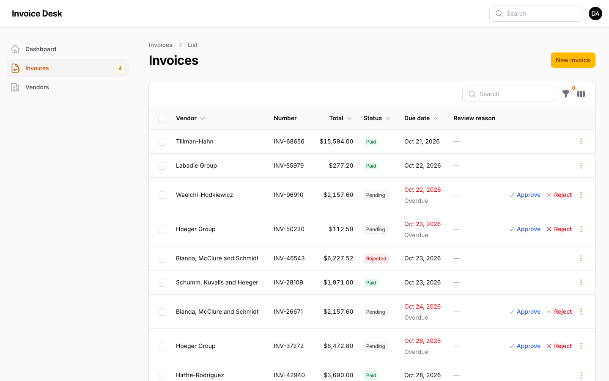
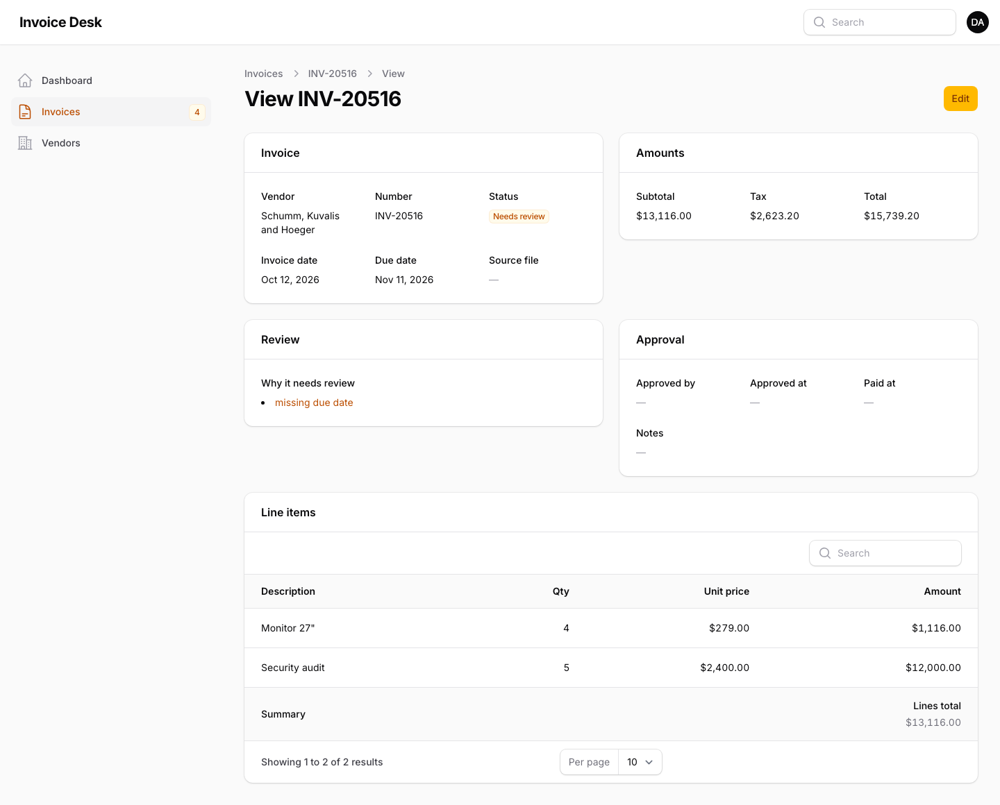

# Invoice Desk: Laravel 13 + Filament 5 approval panel

An accounts-payable panel where the finance team reviews, approves and pays supplier invoices. Invoices arrive automatically through a token-protected API, from the [Invoice Extractor](../invoice-extractor) or an [n8n flow](../n8n-invoice-flow). Anything whose numbers don't add up lands in "Needs review" with the reason.







## Features

- **Approval workflow with enforced rules:** pending/needs-review → approved → paid, or rejected. Paid and rejected are final.
  - Actions appear only when the move is allowed.
  - Approval records who and when.
  - Rejecting requires a reason.
  - Status can't be edited through the form, only through the actions.
- **Bulk approve** that skips invoices already approved, paid or rejected, and says how many it skipped.
- **Table built for daily work:**
  - money in each invoice's own currency
  - overdue dates in red
  - review reasons inline
  - filters for status, vendor and overdue only
  - a navigation badge with the review count
- **Line items** as a relation manager. The amount is calculated from qty × unit price, with a summed total.
- **Dashboard:** needs-review count, overdue, approved and due within 7 days, paid this month, plus a status chart. Totals are shown per currency and never added across currencies.
- **Ingestion API** at `POST /api/invoices`:
  - Sanctum token with an `invoices:write` ability
  - full validation and rate limiting
  - idempotent per vendor + number: re-sending updates the invoice and replaces its lines
  - returns **409** instead of overwriting an invoice that's already approved, paid or rejected
- **Panel access:** open in local development. Elsewhere, only emails listed in `PANEL_ADMIN_EMAILS` can get in.

## Works with the rest of the pipeline

```bash
# PDF -> Python extractor -> this panel (the extractor's JSON is the API's input format)
curl -s -F file=@invoice.pdf http://127.0.0.1:8077/extract \
  | curl -s -X POST http://127.0.0.1:8089/api/invoices -H "Authorization: Bearer $TOKEN" \
         -H "Content-Type: application/json" -H "Accept: application/json" --data-binary @-
# {"id":46,"status":"pending","updated":false}
# {"id":47,"status":"needs_review","updated":false}   <- totals didn't add up
```

## Run it (Docker, no local PHP needed)

```bash
./dev.sh composer install
cp src/.env.example src/.env && ./dev.sh php artisan key:generate
./dev.sh php artisan migrate:fresh --seed            # demo data + local login admin@example.com / password
PORT=8089 ./dev.sh php artisan serve --host 0.0.0.0 --port 8089   # http://127.0.0.1:8089/admin
./dev.sh php artisan invoices:token admin@example.com              # API token for n8n / the extractor
```

`dev.sh` runs commands in a PHP 8.4 container (with the intl, zip and bcmath extensions) as your own user. With local PHP and Composer, run the same commands inside `src/` directly.

## Tests

```bash
./dev.sh php artisan test      # 18 tests, 72 assertions
```

**API tests:**
- auth required, and the token ability required
- creating an invoice with its vendor and lines
- problems → needs review
- a resend updates instead of duplicating
- an approved invoice is never overwritten (409)
- validation errors

**Panel tests (Livewire):**
- status rules, and an invalid transition throws
- pages render
- approve records who and when
- actions are hidden when not allowed
- reject requires a reason
- bulk approve skips final invoices
- the overdue filter
- per-currency totals
- the panel is locked to listed admins outside local

## Stack

Laravel 13 · Filament 5 · Sanctum · SQLite (any Laravel database works) · PHPUnit · Docker
