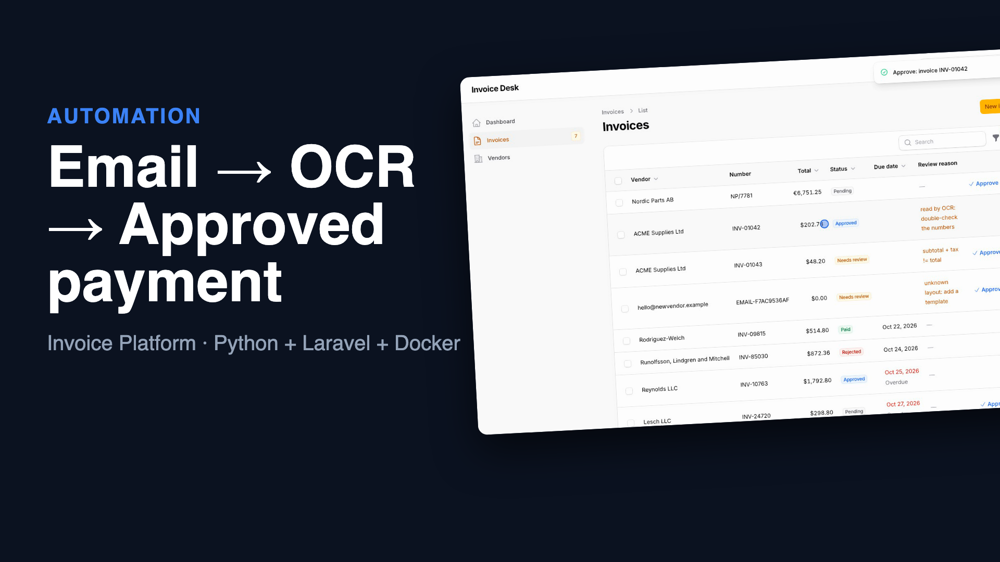
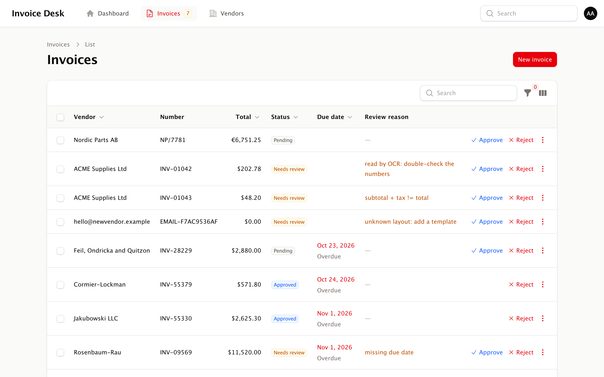
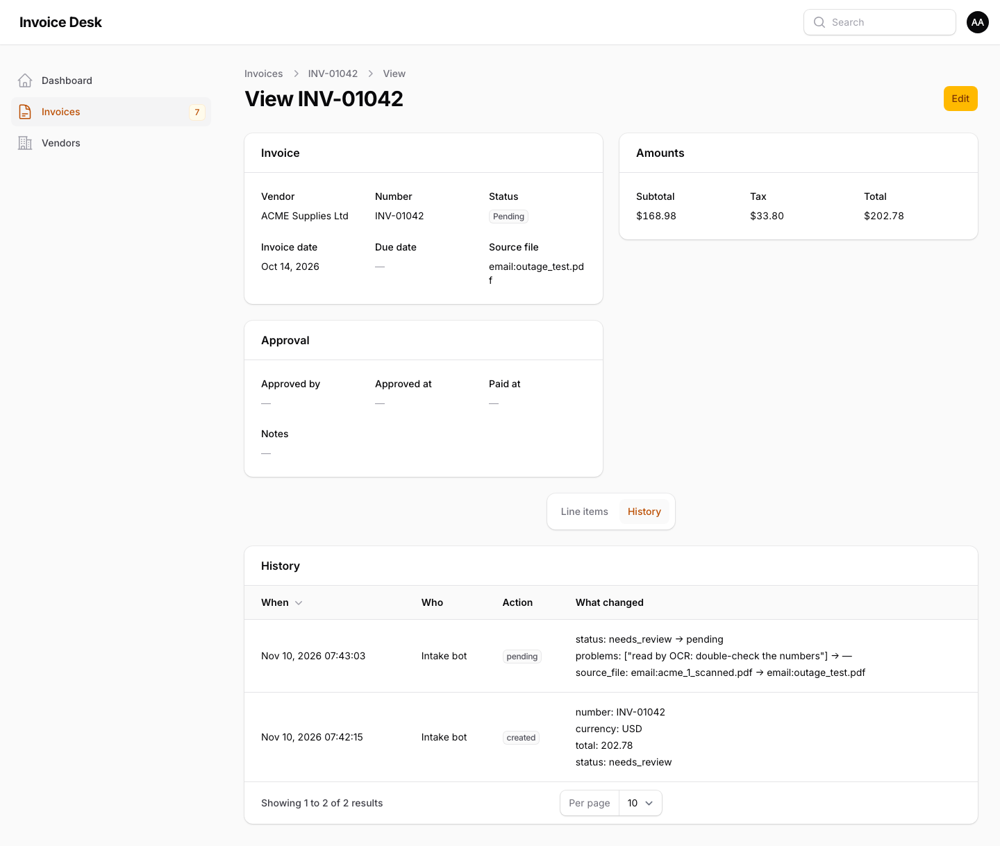

# Invoice Platform: from supplier email to approved payment

A complete accounts-payable intake system that runs with one command. Suppliers email PDF invoices to an AP inbox. A worker picks them up, an extraction service reads them (including **scanned PDFs, via OCR**), and every invoice lands in an approval panel. Clean invoices are ready to approve; anything doubtful waits in a review queue with the reason. Approval and payment are separated between people, and every step is in an audit trail.

```
supplier email ──▶ IMAP inbox ──▶ intake worker ──▶ extractor API (text + OCR) ──▶ Invoice Desk panel
   (PDF)                          retries, no loss     arithmetic checks           roles, four-eyes, audit trail
```

**▶ [Watch the 1-minute demo](docs/demo.mp4)**: a real recording of the running stack. Emails arrive, a scanned PDF is read by OCR, one person approves and another pays, and the audit trail shows it all. It was recorded with Playwright by [`demo/record.py`](demo/record.py) and edited in Remotion ([`demo/video`](demo/video)).

[](docs/demo.mp4)





## Run it

```bash
./setup.sh                      # writes .env with fresh random secrets (app key, API tokens, mail password)
docker compose up --build       # panel on http://localhost:8080
```

Log in as `admin@`, `approver@`, `payer@` or `viewer@example.com` (password `password`, local demo data only). To send a test invoice to the inbox:

```bash
./e2e.sh                        # emails 5 test messages and checks the results (see below)
```

## What's in the stack

| Service | What it is | Source |
|---|---|---|
| `panel` | Laravel 13 + Filament 5 on FrankenPHP: approval workflow, roles, four-eyes rule, audit trail, token-protected ingestion API | [filament-ops-panel](../filament-ops-panel) |
| `extractor` | FastAPI service: PDF → invoice fields and line items; arithmetic checks; Tesseract OCR for scanned PDFs | [invoice-extractor](../invoice-extractor) |
| `intake` | Python worker: polls the inbox over IMAP and files each PDF attachment | [`intake/`](intake) |
| `mail` | GreenMail test server (SMTP + IMAP) standing in for the real AP mailbox | image |

In production, point `IMAP_*` at the real mailbox (Gmail, Outlook or any IMAP server, port 993 with SSL) and drop the `mail` service.

## Design decisions

- **No invoice is ever lost:**
  - An email is marked read only after every PDF in it was filed.
  - If the panel or the extractor is down, the email stays unread and is retried on the next poll. This was checked by stopping the panel mid-run: the invoice was filed seconds after the panel came back.
- **Retries are safe:** the panel upserts by vendor + invoice number and returns 409 instead of overwriting an approved or paid invoice. Re-sending the same email never creates a duplicate.
- **Unreadable mail still reaches a human:**
  - an unknown vendor layout is filed under the sender's address with a stable `EMAIL-…` number
  - an oversized attachment is filed straight to review without being processed
  - OCR results are flagged "double-check the numbers"
- **Segregation of duties:**
  - viewers only look
  - approvers approve or reject
  - payers mark paid, but never an invoice they approved themselves
  - the rule is enforced in the policy and again in the model, so no code path can skip it
- **Audit trail:** every create, edit, approval, payment and rejection is recorded with the acting user and a field-by-field diff. Invoices from the inbox are attributed to the intake bot's API token.
- **Secrets:** generated per install by `setup.sh` into a `chmod 600` `.env`. The extractor is not published to the host. Containers run as non-root users.

## Verified end to end

`e2e.sh` starts the real stack, sends 5 emails over SMTP, and asserts what the panel's database contains:

```
pending       Nordic Parts AB              NP/7781             6751.25
needs_review  ACME Supplies Ltd            INV-01042            202.78  ["read by OCR: double-check the numbers"]
needs_review  ACME Supplies Ltd            INV-01043              48.2  ["subtotal + tax != total"]
needs_review  hello@newvendor.example      EMAIL-F7AC9536AF          0  ["unknown layout: add a template"]
PASS: 4 invoices filed (1 ready to approve, 3 in review), 1 email ignored, all attributed to the intake bot
```

The scanned invoice has no text layer at all; OCR recovers the same number, total and line items as the original.

## Tests

| Part | Tests |
|---|---|
| Intake worker | 8 unit tests: filing, outage retry, 409 handling, sender allowlist, oversized PDF, unknown layout, OCR flag, path-stripped filenames (`uv run pytest -q`) |
| Panel | 26 feature tests: roles, four-eyes, audit trail, API, workflow (`../filament-ops-panel`) |
| Extractor | 14 tests, including real OCR when Tesseract is installed (`../invoice-extractor`) |
| Whole system | `e2e.sh`, also run in CI |
