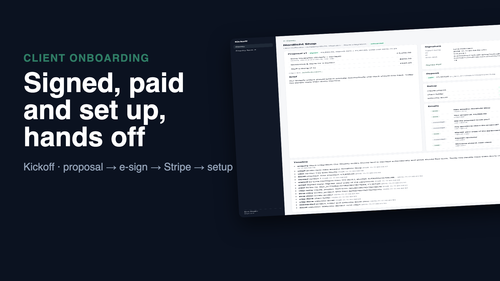
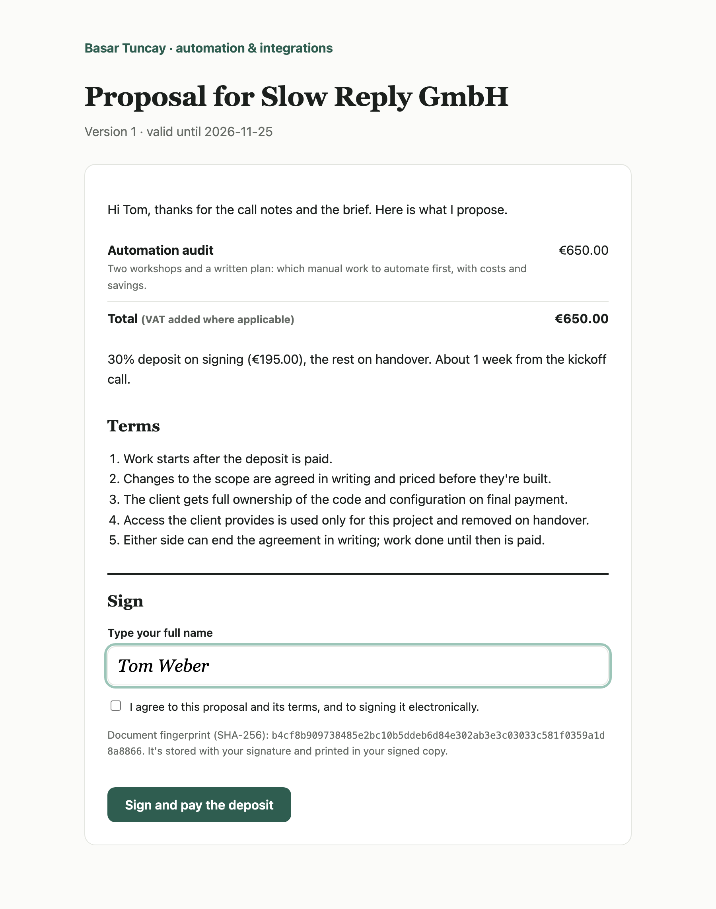
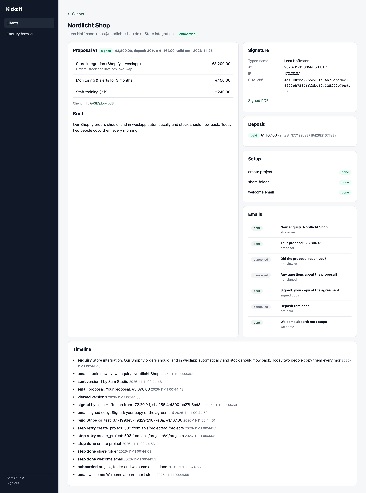

# Kickoff: from "can you help us?" to a signed, paid, set-up project, without the admin

Freelancers and small studios lose days between an enquiry and the first working hour:
- a proposal written in a doc
- a PDF to sign
- an invoice for the deposit
- then by hand: a project board, a shared folder and a welcome email

Kickoff does that path end to end and keeps a record of every step:

```
enquiry form ─▶ draft proposal from a package ─▶ studio edits & sends ─▶ client opens link ─▶ types name, signs
                                                                                                │ SHA-256 of the exact text,
                                                                                                │ signed PDF emailed
 onboarded ◀── welcome email ◀── shared folder ◀── project + tasks ◀── deposit paid ◀── Stripe Checkout
               (kickoff link)    (Drive-style)     (Linear-style)     (signed webhook)
```

**▶ [Watch the 1-minute demo](docs/demo.mp4)**: a real recording of the running stack, made with [`demo/record.py`](demo/record.py) (Playwright) and [`demo/video`](demo/video) (Remotion).

[](docs/demo.mp4)

| What the client signs | What the studio sees |
|---|---|
|  |  |

An example of the signed PDF the client receives: [docs/signed-example.pdf](docs/signed-example.pdf), with the agreement and a signature certificate.

## Run it

```bash
./setup.sh                      # writes .env with random secrets
docker compose up --build       # enquiry form http://127.0.0.1:8104 , studio panel /board (local demo login: studio@example.com / password)
```

The stack includes:
- **A local mail server** holding the clients' mailboxes.
- **A local `apis` service** standing in for three outside services:
  - **Stripe:** Checkout Sessions, a hosted payment page and signed webhooks. No card, no account.
  - **A project tool**
  - **File storage**

  They use the real request shapes. For real use, point `STRIPE_URL` at `https://api.stripe.com` with your keys, set your project tool and storage, and use real SMTP.

## How it decides

- **The client signs exactly what they read.**
  - The agreement text is rendered from the proposal.
  - Its SHA-256 is shown on the signing page and sent back with the signature.
  - If the proposal changed while the page was open, signing is refused: "please reload and read it again".
  - The signature record (typed name, email, time, IP, browser, fingerprint) is stored, and the signed PDF gets a certificate page with the same fingerprint.
- **Sent proposals aren't edited in place.** Withdraw & revise makes a new version with a new link; the old link stops working.
- **Proposals expire.** After the valid-until date the link says so and can't be signed.
- **Payment is the webhook, not the redirect.** Back on the success page, the client sees a thank-you, but the client only counts as paid when a `checkout.session.completed` webhook arrives and passes every check:
  - The `Stripe-Signature` is verified (HMAC over `t.payload`).
  - The signature is under 5 minutes old (no replays).
  - The event ID hasn't been seen before (Stripe retries).
  - The amount matches the session.
- **One deposit, one session.** The session is created with an `Idempotency-Key`, so a double click or a revisit never opens a second charge.
- **Setup steps are safe to retry.**
  - Create the project, share the folder, send the welcome email: each step finds before it creates.
  - Retrying after a timeout never makes a second project or a second share.
  - Steps run in order, with backoff. A step that keeps failing stops the ones after it and shows a Retry button.
- **Reminders that know the context.** They're queued by the step that makes them relevant and cancelled by the step that makes them moot:
  - "Did the proposal reach you?" (not opened in 3 days)
  - "Any questions?" (opened, not signed in 4 days)
  - "Deposit reminder" (signed, not paid in 2 days)

  Nobody gets "did you see our proposal?" after signing it.
- **The public form:** a honeypot field, a per-connection limit, server-side validation, and unknown package options ignored.

## Verified end to end

`./e2e.sh` runs the stack in Docker with a real mail server. The client and the studio are driven over HTTP and IMAP:

```
PASS enquiry: public form created a client with a draft proposal from the package; the studio got an email
PASS proposal: studio edited the draft (3 lines, €3,890) and sent it; the client got the link by email
PASS signing: a stale fingerprint was refused; signed with sha256 4ef300fbc27b…, signed PDF emailed, sent on to Stripe Checkout
PASS payment + setup: deposit paid, project (5 tasks) and shared folder created through 2 outages, welcome email with both links
PASS webhooks: a retried event changed nothing; an hour-old replay and a forged signature were refused
PASS reminders: the unopened proposal got a reminder; the client who signed never got one
```

## Tests

```bash
uv sync && uv run pytest -q      # 9 tests
```

**Covered:**
- package drafts and validation
- reminder scheduling and cancelling
- signing (fingerprint, consent, double signing, expiry)
- versions and dead links
- Stripe signatures (forged, replayed, tampered)
- payment checks (amount, duplicates)
- provisioning retries, crash recovery without duplicates, and a failing step blocking the rest
- the public pages and the panel

## Good to know

- The typed-name signature with an audit trail is a "simple electronic signature" (eIDAS SES), which is fine for most service agreements. Contracts that legally need a qualified signature need a QES provider instead.
- The PDF uses the built-in Latin-1 fonts; names in other scripts need an embedded TTF font (one line in `pdf.py`).

## Stack

Python 3.12 · FastAPI · SQLite (WAL) · fpdf2 · httpx · smtplib · Jinja2 · Docker · GreenMail · GitHub Actions
