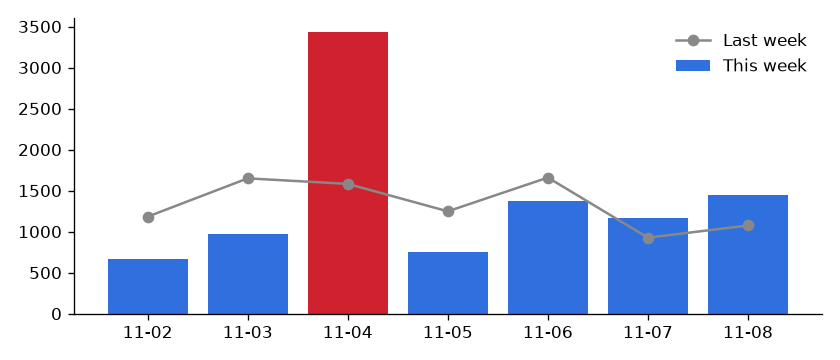

# Weekly KPI Report Automation

Replaces the Monday-morning spreadsheet ritual. From raw order data it computes the week's KPIs, compares them with last week, flags unusual days, writes a formatted Google Sheets tab and emails an HTML summary with a chart.



## What it reports

- **KPIs with change vs last week:** revenue, orders, average order value, units and refund rate. A change against a zero baseline shows "n/a" rather than a nonsense percentage.
- **Daily revenue** for the week, with **anomaly flags**: days more than 3 standard deviations from the trailing 4-week daily average. With less than a week of history it flags nothing rather than guessing. On the sample data only the promo day (Nov 4) is flagged.
- **Top 5 products** by revenue.
- **Refunds** are excluded from revenue and reported separately.

## Outputs

| Output | How |
|---|---|
| `report/report.html` and `report/daily.png` | always |
| Google Sheet tab "Weekly report", with bold header and number formats | when `GOOGLE_SHEET_ID` is set (service account) |
| HTML email with the chart inline | `--email-to` plus `SMTP_HOST/PORT/USER/PASSWORD/FROM` |

Product names are HTML-escaped in the email.

## Run it

```bash
uv sync                      # add --extra sheets for Google Sheets
uv run python make_orders.py # 6 weeks of synthetic orders with one promo spike
uv run python -m kpi_report samples/orders.csv --week-start 2026-11-02
# week 2026-11-02: revenue 9,805.10, 174 orders, anomalies ['2026-11-04'] -> report/report.html
```

With no `--week-start` it reports the last full Monday–Sunday week, so it's ready for a weekly cron or GitHub Actions schedule.

**Input:** a CSV with `order_id, date, product, qty, revenue, status`. For a client, replace `read_orders` with their source: Shopify, Stripe, WooCommerce, a database or a Google Sheet.

## Tests

```bash
uv run pytest -q
```

They cover:
- week boundaries, and excluding refunds and other weeks
- the zero-baseline change
- the anomaly rules (needs history; flags only the spike)
- the sheet layout
- HTML escaping and the alert in the email
