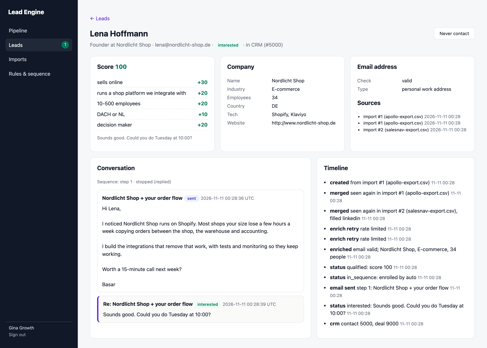
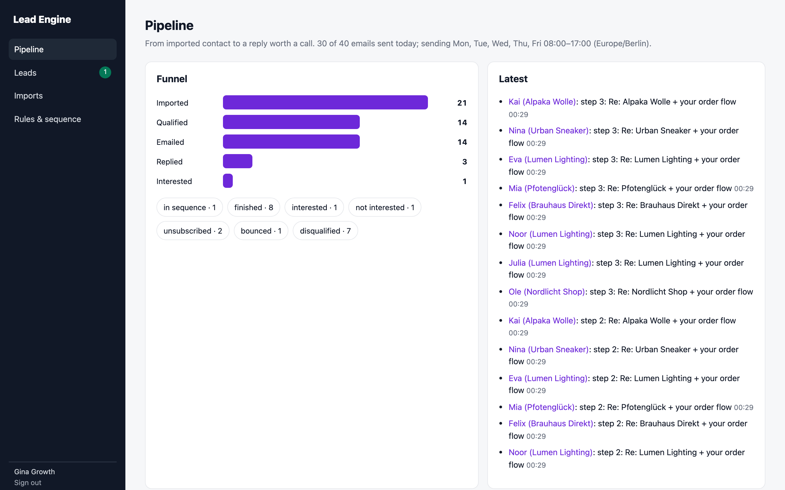

# Lead Engine: from a CSV export to a booked call, without spamming anyone

Most outbound setups are five tools glued together: an export from Apollo, a spreadsheet, an enrichment tool, a mail tool and the CRM. Duplicates, dead addresses and people who said "no" leak between them. Lead Engine is one pipeline that owns the whole path:

**import → merge → verify → enrich → score (with reasons) → sequence → read replies → hand interested people to the CRM**

```
 Apollo / Sales Nav CSV ─┐                    ┌─ verify address (ZeroBounce-style API)
 signed website form ────┼─▶ normalise, merge ┤                                       ─▶ score with explained points
                         │   by email, skip   └─ company by domain, cached 30 days       │ ≥ threshold
                         │   suppressed            (Clearbit/Apollo-style API)            ▼
                         │                                                   3-step sequence over SMTP,
   sales inbox (IMAP) ◀──┴── replies: interested · out of office · unsubscribe ◀── same thread, window + daily cap
                              · not interested · bounce          │ interested
                                                                 ▼
                                                      CRM contact + deal (HubSpot API)
```

| Every point explained, every email in one thread | The funnel |
|---|---|
|  |  |

## Run it

```bash
./setup.sh                      # writes .env with random secrets
docker compose up --build       # panel on http://127.0.0.1:8100 (local demo login: growth@example.com / password)
```

Then import [`samples/apollo-export.csv`](samples/apollo-export.csv) on the Imports page.

The stack includes:
- **A local mail server** holding every prospect's mailbox and the sales inbox.
- **A local `apis` service** standing in for the three paid APIs:
  - company enrichment
  - email verification
  - a HubSpot-style CRM
  
  They use the real request shapes, so nothing touches a paid account. For real use, point `DATA_API_URL`, `CRM_URL`, SMTP and IMAP at your providers and set `IGNORE_SEND_WINDOW=false`.

## How it decides

- **Merging.**
  - Leads are merged by normalised email.
  - The first source's values are kept; a later file only fills blanks (a LinkedIn URL, a title) and is recorded as another source of the lead.
  - Column names are recognised in English and German exports, with comma, semicolon or tab separators, in UTF-8 or Windows Excel encoding.
  - Each import has a report: which column mapped to what, and every row that was merged, invalid or suppressed.
- **Scores you can argue with.**
  - Rules are plain JSON, editable in the panel. Examples: "sells online +30", "runs Shopify/WooCommerce/Shopware +20", "decision maker +20", "shared inbox like info@ −40", "catch-all domain −10", "personal email provider −30".
  - Each lead shows the rules it hit.
  - An address the verifier couldn't confirm never qualifies, whatever its score.
- **One lookup per company, not per person.** Enrichment is cached by domain for 30 days. For people using Gmail, the company comes from their website instead.
- **Rate limits and outages.** A `429` stops the batch and waits for `Retry-After`; a `5xx` is retried next cycle. A lead is never scored on half the data.
- **Sending like a person, not a blaster.**
  - Steps 2 and 3 go out as replies in the same thread (`In-Reply-To`, `References`, "Re:").
  - Sending happens only on weekdays in office hours, in the configured time zone, under a daily cap.
  - Each enrollment is leased before its email is sent, so two workers can't send it twice.
- **Checked again before every email.** The lead's status and the do-not-contact list are re-read right before sending. An unsubscribe that arrived a minute ago wins over the schedule.
- **Replies are sorted, not guessed.**
  - Each reply is matched to its lead by thread headers. A bounce is matched by its `Final-Recipient`.
  - It's sorted into one of five kinds:
    - a bounce
    - an auto-reply (from `Auto-Submitted` or the wording, in English and German)
    - an unsubscribe
    - not interested
    - everything else, treated as a human reply worth a call
  - Quoted text is cut off first, so "unsubscribe" in our own footer doesn't count.
  - An out-of-office reply with a return date moves the next email to the day after it.
  - Unsubscribes, bounces and "not interested" go on the suppression list, so a later import can't bring them back.
- **Unsubscribe in one click.**
  - Every email has a signed link plus `List-Unsubscribe` and `List-Unsubscribe-Post` headers (RFC 8058), so mail clients can show their own unsubscribe button.
  - The token is an HMAC of the lead ID; it can't be guessed for another person.
- **Only real interest reaches the CRM.** An interested reply creates a contact and a deal with the reply text on it. An existing contact (a `409`) gets the deal attached instead of a duplicate.
- **Inbound leads.** Leads from website forms arrive through a webhook signed with `X-Signature: sha256=<HMAC of the body>`.

## Verified end to end

`./e2e.sh` runs everything in Docker against a real SMTP/IMAP server. The panel is driven over HTTP, and replies are sent as real emails:

```
PASS intake: Apollo + Sales Navigator exports imported, duplicates merged, invalid and suppressed rows skipped, signed form lead accepted, forged one refused
PASS scoring: enriched through a rate limit, dead mailbox and weak fits disqualified with reasons
PASS sequence: personalised first email delivered to qualified leads only, with one-click unsubscribe headers
PASS replies: interested, out of office, unsubscribe, not interested and a bounce read over IMAP and sorted; unsubscribe link worked
PASS crm: only the interested lead became a contact + deal, with the reply on the deal
PASS follow-ups: steps 2 and 3 sent in the same thread to people who didn't answer; nobody who replied got another email
```

## Tests

```bash
uv sync && uv run pytest -q      # 8 tests, against the API stand-ins
```

**Covered:**
- import and merge rules
- scoring
- rate limits
- threading
- suppression between steps
- the daily cap and the sending window
- all five reply kinds
- duplicate deliveries
- the CRM handoff with an existing contact
- the unsubscribe token
- the form webhook signature
- the panel's rule and template validation

## Before sending real email

- **Cold email law differs by country.** In Germany, unsolicited B2B email needs consent or a strong presumed interest. Many teams use this pipeline for warm lists (event contacts, inbound forms, past customers). Configure the sources and rules for your situation.
- **Use a separate sending domain** with SPF, DKIM and DMARC set up, warm it up slowly, and keep the daily cap low at first.

## Stack

Python 3.12 · FastAPI · SQLite (WAL) · smtplib / imaplib · httpx · Jinja2 · Docker · GreenMail · GitHub Actions
