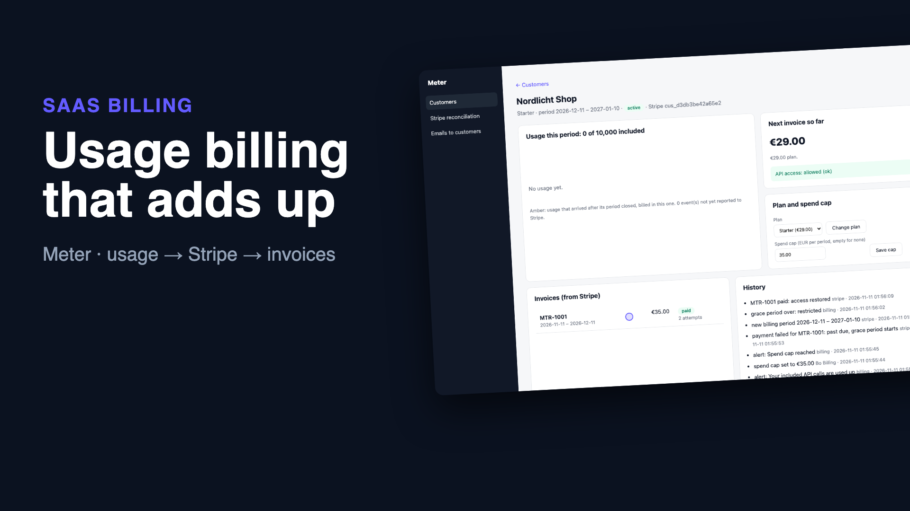
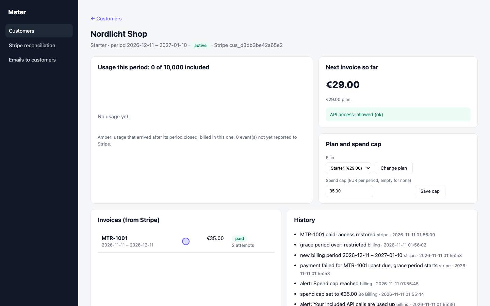
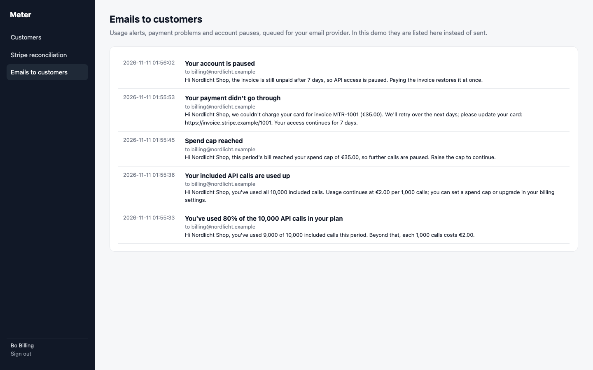

# Meter: usage-based billing on Stripe, without surprises

Charging per API call (or per document, message, minute) looks simple until you get the details wrong:
- a client retries a batch and the customer is billed twice
- a crash between "sent to Stripe" and "marked as sent" bills it twice again
- the customer finds a €900 overage on an invoice nobody warned them about
- a declined card cuts off a paying customer the same minute

Meter sits between your product and Stripe Billing and gets those details right.

```
 your product ─ POST /v1/events (batch, idempotency key per event) ─▶ count once ─▶ report to Stripe's meter (identifier per event)
             └ GET /v1/entitlement ◀─ allowed? (plan, spend cap, unpaid invoice)       │
                                                                                    Stripe: subscription (flat + metered price),
 customer emails ◀── 80% / 100% of included usage, cap reached, payment failed      invoices, card retries ─▶ signed webhooks
 panel ◀── usage, next invoice so far, plan changes, reconciliation against Stripe ◀──────────────────────────────┘
```

**▶ [Watch the 63-second demo](docs/demo.mp4)**: a real recording of the running stack, made with [`demo/record.py`](demo/record.py) (Playwright) and [`demo/video`](demo/video) (Remotion).

[](docs/demo.mp4)

| A customer through a whole period | What the customer was told |
|---|---|
|  |  |

## Run it

```bash
./setup.sh                      # writes .env with random secrets
docker compose up --build       # panel on http://127.0.0.1:8112 (local demo login: billing@example.com / password)
```

The `stripe` service is a **local stand-in** for Stripe Billing with its request shapes:
- form-encoded writes, basic auth with the secret key, `Idempotency-Key`
- customers and subscriptions with a flat and a metered price
- Billing Meter events, deduplicated by `identifier`, and event summaries
- prorations and invoices at period end
- declined cards and retries
- `Stripe-Signature` webhooks

For real use, point `STRIPE_URL` at `https://api.stripe.com`, create the prices and the meter in Stripe, and set the webhook endpoint to `/webhooks/stripe`.

## How it decides

- **Counted once, reported once.**
  - Every usage event carries the product's idempotency key, and (customer, key) is unique, so a retried batch adds nothing.
  - Every event goes to Stripe's meter with its own `identifier`, so a resend after a crash is dropped by Stripe.
  - The reconciliation page compares this period's count with Stripe's meter summary.
- **Validated at the door.** Wrong metric, zero or absurd quantities, timestamps in the future or over 35 days old are rejected with a reason per event. The rest of the batch is accepted.
- **Late usage is billed, visibly.** An event from a period that already closed is billed in the current one and marked "late" in the chart, instead of silently vanishing or reopening an invoice.
- **Included usage, then overage.** Each plan includes a number of calls; beyond that, each started 1,000 costs the plan's rate. The panel shows the next invoice *so far* for every customer.
- **No surprise bills.** Customers get an email at 80% and at 100% of what's included, once per period. They can set a **spend cap**; when the bill reaches it, `/v1/entitlement` tells the product to pause usage.
- **Plan changes the fair way.** Upgrades apply at once: usage so far is reported at the old rates and Stripe prorates the price difference. Downgrades wait for the end of the period.
- **Failed payments.**
  - A declined card makes the customer **past due**, not blocked. They get an email with the invoice link while Stripe retries.
  - After the grace period (7 days by default) the account is **restricted**.
  - Paying the invoice restores access at once.
- **Webhooks are verified.** Each one is checked for an HMAC over `t.payload`, a timestamp under 5 minutes old, and an event ID not seen before. API keys are stored only as hashes and shown once.

## Verified end to end

`./e2e.sh` runs the stack in Docker; the product's usage goes through the real API:

```
PASS customers: created in Stripe from the panel with a subscription each; API keys shown once
PASS usage: a retried batch counted once (11,500 calls), €33 projected, 80% and 100% alerts emailed
PASS meter: usage reported to Stripe's meter and reconciled: counts match
PASS invoice: period closed at €33.00, the declined card made it past due, the grace period ended in a restriction; the downgrade took effect
PASS recovery: card updated, Stripe's retry paid the invoice, access restored at once
PASS webhooks: an hour-old replay and a forged signature were refused
```

## Tests

```bash
uv sync && uv run pytest -q      # 7 tests
```

**Covered:**
- validation and duplicates
- the overage maths, alerts once per period, and the spend cap
- idempotent reporting with crash recovery, and reconciliation
- a full period with a failed payment, the grace period and the restore
- late usage
- upgrades and downgrades
- the API keys, the webhooks and the panel

## Not included yet

- A customer-facing usage page (the entitlement endpoint has what it needs)
- Several metrics per customer, and tiered or volume pricing beyond "included, then per 1,000"
- Tax (Stripe Tax would be switched on in the subscription)

## Stack

Python 3.12 · FastAPI · SQLite (WAL) · Stripe Billing (meters, subscriptions, webhooks) · httpx · Docker · GitHub Actions
