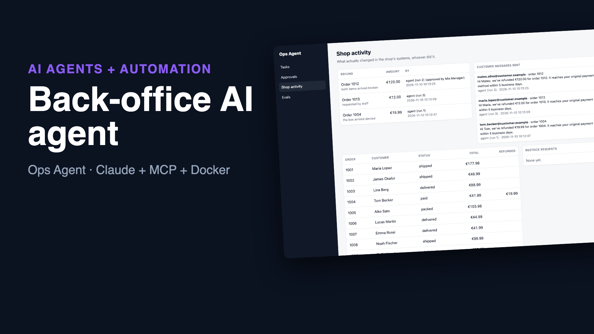
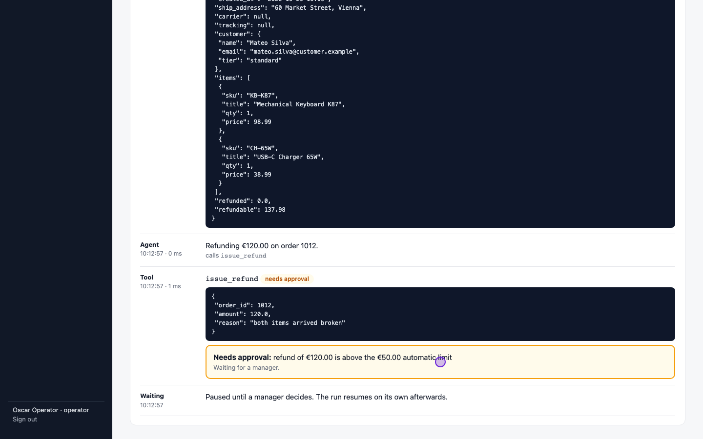

# Ops Agent: an AI agent for back-office work, with a manager in the loop

Staff give the agent tasks in plain words, for example "refund €19.99 on order 1004, the box arrived dented". It looks up the facts through tools, issues the refund, emails the customer and reports back. Every model turn and tool call is kept in a trace.

The limits live in code, not in the prompt:
- Refunds over €50, every cancellation and big restocks wait for a manager. The paused run resumes on its own once someone decides.
- An impossible action, like refunding more than was paid or cancelling a shipped order, is refused outright.

The same tools are served over **MCP**, so Claude Desktop or Claude Code work under the same limits.

```
task (panel / API / n8n) ──▶ agent loop ──▶ tools ──▶ policy ──▶ shop data (orders, refunds, messages, stock)
                              Claude or        │        │
                              offline planner  │        └── over a limit? ──▶ approval queue ──▶ manager ──▶ run resumes
MCP client (Claude Desktop) ──────────────────┘   same tools, same policy
every step ──▶ append-only trace          evals ──▶ check the data after each run, not the wording
```

**▶ [Watch the 70-second demo](docs/demo.mp4)**: a real recording of the running stack, made with [`demo/record.py`](demo/record.py) (Playwright) and [`demo/video`](demo/video) (Remotion).

[](docs/demo.mp4)



## Run it

```bash
./setup.sh                      # writes .env with random secrets
docker compose up --build       # panel on http://127.0.0.1:8093
```

**Local demo accounts** (password `password`):

| Account | Can do |
|---|---|
| `operator@example.com` | give the agent tasks |
| `manager@example.com` | also approve or reject held actions |
| `viewer@example.com` | read only |

- **Let Claude drive it:** add `ANTHROPIC_API_KEY=...` to `.env`. The agent then runs on Claude Opus 5.5, with strict tool schemas, `effort: medium` and server-side fallback on refusals. Without a key, a deterministic **offline planner** handles the common task shapes (refund, cancel, address change, order status, restock). It is free and repeatable, and it is what CI and the demo use. Tools, policy, approvals and traces are identical either way.
- **From other systems:** `POST /api/tasks {"task": "..."}` with `Authorization: Bearer $API_TOKEN` (for n8n, a helpdesk webhook or cron). Read the result with `GET /api/runs/{id}`.
- **As an MCP server:** add this to Claude Desktop's config (`mcpServers`):
  ```json
  {"shop-ops": {"command": "docker", "args": ["compose", "-f", "/path/to/ops-agent/docker-compose.yml",
                "exec", "-T", "web", "python", "-m", "ops_agent.mcp_server"]}}
  ```

## The tools and their limits

| Tool | Runs on its own | Waits for a manager | Always refused |
|---|---|---|---|
| `get_order`, `find_customer`, `list_customer_orders`, `check_inventory` | yes (read-only) | | |
| `issue_refund` | up to `AUTO_REFUND_LIMIT` (€50) | above it | more than the order's refundable amount |
| `cancel_order` | | always | orders already shipped or delivered |
| `update_shipping_address` | before shipping | | after shipping |
| `create_restock_request` | up to `AUTO_RESTOCK_LIMIT` (100 units) | above it | unknown SKUs |
| `send_customer_message` | yes (logged with the run that sent it) | | empty or over 1500 characters |

## Design decisions

- **The policy is code, not a prompt.**
  - Every call goes through `tools.call()`, whoever makes it: the in-app agent, an MCP client or a test.
  - A model that is confused, or talked into something by text in an order note, still can't exceed the limits.
  - What the policy can't do is tell a fooled model from a correct one. Under the limit, an unrequested action runs. So the limits set the worst case, and the trace and evals catch the rest. A test documents exactly this: [`test_a_fooled_model_is_bounded_by_the_policy`](tests/test_ops.py).
- **Approvals survive restarts.** The conversation is saved after every turn. A run held for approval can resume hours later, after a restart, exactly where it stopped. Results of other tool calls in the same turn are kept and returned in the original order.
- **Exactly once.**
  - Tool calls carry an idempotency key (run + tool-call id), so a retry never refunds twice.
  - An approval is claimed atomically, so two managers clicking at once can't run it twice.
  - Approved actions are checked against the policy again when they run.
- **Untrusted text is labelled.** Customer notes reach the model as `customer_note_untrusted`. The system prompt treats customer-written text as information, never instructions. An eval case plants such a note.
- **Evals check what changed, not what was said.** Each of the 14 cases ([`evals/cases.json`](evals/cases.json)) runs on a fresh copy of the shop. It plays the manager when asked, then checks the database with SQL: refund amounts, order statuses, messages sent, approvals. Wording varies from run to run; money moved or not moved doesn't. Run `python -m ops_agent.evals` with an API key to score Claude (each case costs a few cents). The panel shows the latest report.
- **Traces you can audit.** Every model turn, tool call (with arguments and result), approval and decision is stored append-only, with SQLite triggers blocking updates and deletes. The panel shows them as a timeline per run, with token counts and cost.
- **Panel basics.** Signed SameSite=strict session, CSRF on every form, scrypt passwords, role checks on every action, container runs as non-root.

## Verified end to end

`./e2e.sh` starts the stack from an empty volume. It sends two tasks through the API: a €19.99 refund runs on its own, and a €120 refund is held. It then signs in as the manager, approves the refund and checks the shop data and the trace. Next it runs the 14 evals inside the container. Finally it connects an MCP client to the server: an over-refund is refused and a cancellation is queued for a manager. CI runs it on every push.

```
PASS api+panel: small refund automatic, large refund held, approved, executed, traced
14/14 passed with Offline planner (no API key) (cost $0.0000)
PASS mcp: over-refund refused, cancellation queued for a manager
```

## Tests

```bash
uv sync && uv run pytest -q      # 12 tests, offline
```

**Policy tests:**
- limits apply to any caller
- a retried call refunds once
- the untrusted note is labelled
- a scripted "fooled model" is bounded by the policy

**Agent loop tests:**
- pause for approval, restart, resume
- a second click does nothing
- a rejection reaches the model and nothing moves
- the Claude request shape: strict tools, effort, fallback, system prompt

**Evals, MCP and panel tests:**
- all 14 evals pass offline
- an MCP client gets the same tools and limits
- panel roles, approve flow, API token, CSRF

## Stack

Python 3.12 · Claude API (tool use, strict schemas) · MCP (Python SDK 2.x) · FastAPI · Jinja2 · SQLite (WAL) · Docker · GitHub Actions
