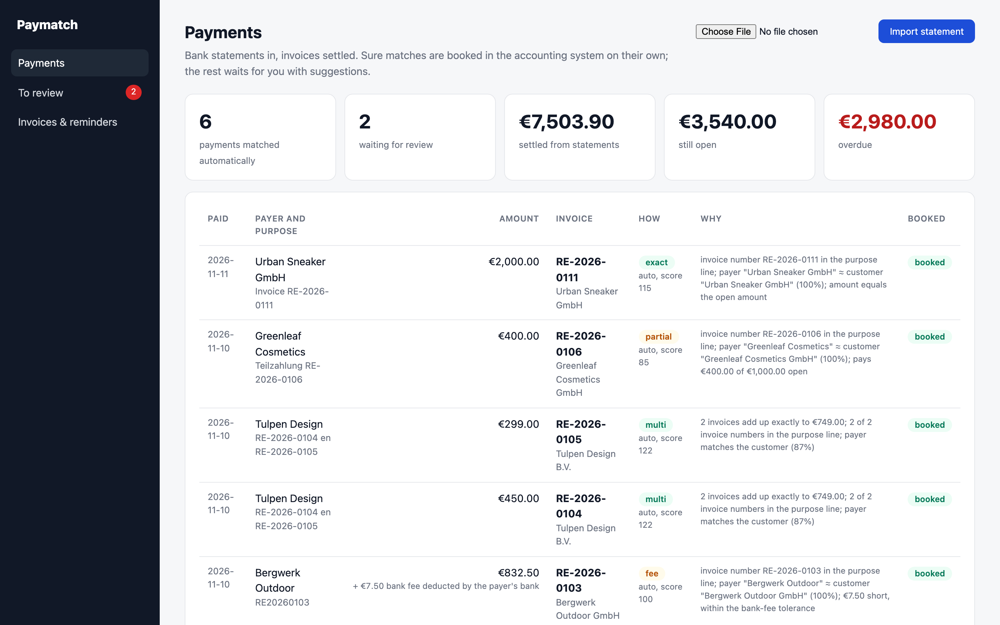
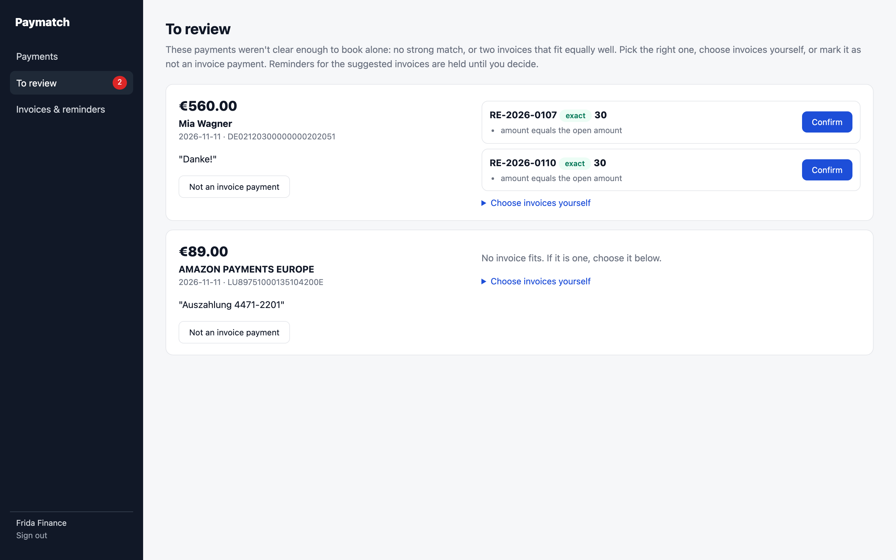

# Paymatch: bank statement in, invoices settled, reminders only where they're due

Someone in finance matches bank lines to invoices every morning, and the messy cases eat the time:
- "Rechnung 2026 0102 abzgl. 2% Skonto"
- a foreign bank keeping €7.50
- one transfer paying two invoices
- €560 from a private account with "Danke!" as the only text

Paymatch reads the statement, settles what it is sure about in the accounting system, explains every decision, and puts only the unclear ones in front of a person. Reminders then go to the customers who really haven't paid.

```
 CAMT.053 XML ─┐                     ┌─ sure (score ≥ 80, 20 ahead of the next) ─▶ booked in accounting
 bank CSV ─────┼─▶ import once ──▶ score against ─┤   with write-offs for discount and fees
               │   (bank ref or    open invoices  └─ unclear ─▶ review queue with the top 3 suggestions
               │    same booking)  (mirrored)                    │ (reminders for those invoices held)
               │                                                 ▼
               └──────────────────────────────▶ daily reminders, level 1/2/3, only for what's really open
```

| Every match explained | The two a person has to decide |
|---|---|
|  |  |

## Run it

```bash
./setup.sh                      # writes .env with random secrets
docker compose up --build       # panel on http://127.0.0.1:8106 (local demo login: finance@example.com / password)
uv run python -m paymatch.demo_data samples/   # statements dated today, so the discount window and due dates fit
```

Then import `samples/statement.camt053.xml` and `samples/umsaetze.csv` on the Payments page.

The `apis` service is a **local stand-in** for the accounting system (sevDesk/lexoffice style): paginated open invoices, and a payments endpoint that is idempotent by `external_id`. A local mail server receives the reminders.

## How it decides

- **Points with reasons, not a black box.**
  - Invoice number in the purpose line: +60. It's still found when mangled: `RE20260103`, `Rechnung 2026 0102`.
  - Customer number: +15.
  - Payer name similar to the customer: up to +25. Legal forms like GmbH, B.V. and UG (haftungsbeschränkt) are ignored.
  - Exact amount: +30.
  - Paid before the invoice date: −50.
- **Discounts, fees, part payments.** The amount is read in context:
  - **Early-payment discount (Skonto):** 2% less, paid within 10 days. It's settled with the discount booked as a write-off.
  - **Bank fee:** a few euros short with a strong reference. It's settled with a fee write-off.
  - **Part payment:** less than open. It's booked as partial; the rest stays open.
  - **Overpayment:** the rest stays as credit.
- **Several invoices in one transfer.** Open invoices of the payer are summed in combinations of 2 and 3. An exact sum over invoices named in the purpose line beats any single-invoice guess.
- **Booked alone only when sure.** That means a score of at least 80 *and* 20 points ahead of the runner-up. The €560 with "Danke!" fits two invoices equally well, so it goes to review instead of being guessed.
- **Imported once.** Entries are keyed by the bank's own reference. The same booking arriving in another export (a CSV overlapping the CAMT file) is recognised by date, amount, IBAN and purpose.
- **Booking can't double-pay.**
  - Every booking carries an `external_id`, so a retry after a timeout is answered with `409` and counted as done.
  - The local open amount is the accounting system's open amount minus our not-yet-booked matches, so a sync in between never makes an invoice look open again.
  - An invoice paid directly in the accounting system is noticed and closed here.
- **Reminders that don't embarrass you.**
  - Three levels: after 7, 21 and 35 days overdue; the last with a fee.
  - Never two within a week, and run once a day at 09:00.
  - Held for invoices that a payment waiting for review might settle.
  - Paused completely when the newest bank data is more than 3 days old.
  - The amount asked for is what's still open after part payments.
- **Hostile files.** Statements are parsed with `defusedxml`, so entity-expansion bombs are refused. Uploads are capped at 10 MB.

## Verified end to end

`./e2e.sh` runs the stack in Docker, uploads both statements through the panel, decides the review queue like a person would, and reads the reminders from the customers' mailboxes:

```
PASS CAMT.053: 9 entries read, 6 payments matched on their own: exact, 2% discount, bank fee, two invoices in one transfer, part payment
PASS CSV: the bank's German CSV export overlapped the CAMT file by 2 bookings, imported once; the new payment matched
PASS booking: payments and write-offs (discount, fee) written to the accounting system through 2 outages, each exactly once
PASS review: €560 from a private name fitted two invoices equally; confirmed by a person, the marketplace payout marked as not an invoice
PASS reminders: only the 2 customers really overdue got one (with the remaining amount); paid customers got none; no second letter the same week
```

## Tests

```bash
uv sync && uv run pytest -q      # 6 tests
```

**Covered:**
- both parsers, duplicates across formats and an XML entity bomb
- every match kind
- review decisions (confirm, manual, ignore)
- booking retries with lost answers, and syncs between matching and booking
- reminder levels, the hold, the weekly gap and the stale-data pause
- the panel

## Not included yet

- MT940 statements, and fetching statements directly from the bank (EBICS or a PSD2 API such as GoCardless or finAPI)
- Outgoing payments matched to supplier bills; debits are only listed today
- Learning from decisions, e.g. remembering that "Mia Wagner" pays for Pfotenglück

## Stack

Python 3.12 · FastAPI · SQLite (WAL) · defusedxml · httpx · smtplib · Jinja2 · Docker · GreenMail · GitHub Actions
