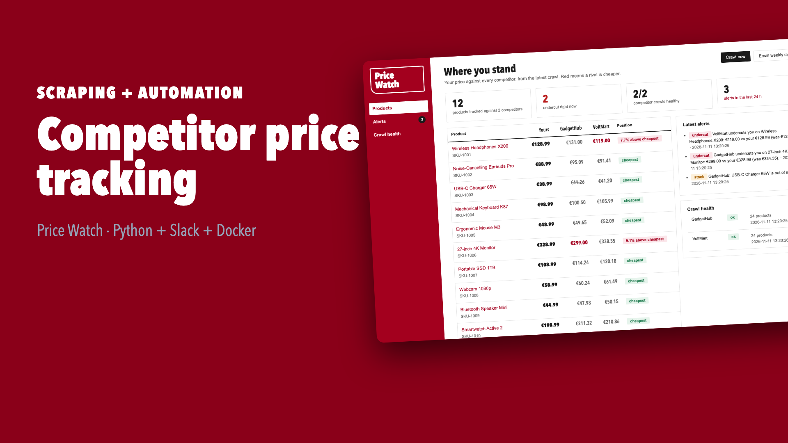
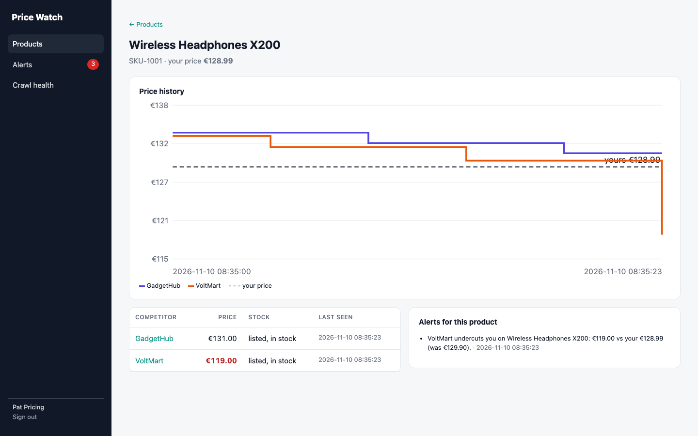
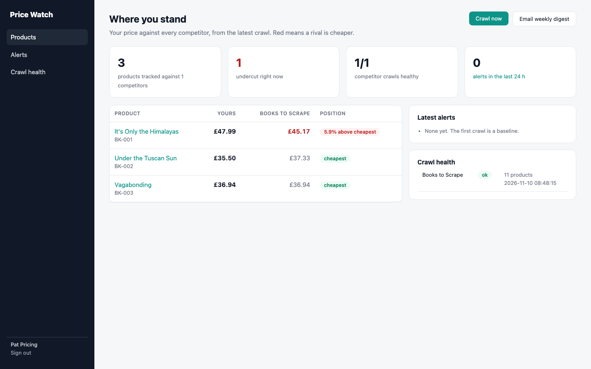

# Price Watch: know the moment a competitor undercuts you

Competitor price tracking that runs itself. On a schedule it crawls each competitor's catalogue and keeps a price history. It alerts Slack or Telegram when a rival undercuts you, cuts a price sharply, or runs out of stock. Every week it emails a digest. The panel shows where you stand on every product you sell.

```
competitor sites ──▶ watcher: crawl (retries, polite delays) ──▶ health check ──▶ diff vs last crawl ──▶ SQLite history
                                                                    │                     │
                                              suspicious? change nothing, one alert       ▼
                                                                        alerts (products you sell only) ──▶ Slack / Telegram
                                                                        weekly digest ──▶ email
                                                                        panel: positions, charts, alerts, crawl health
```

**▶ [Watch the 1-minute demo](docs/demo.mp4)**: a real recording of the running stack, made with [`demo/record.py`](demo/record.py) (Playwright) and [`demo/video`](demo/video) (Remotion).

[](docs/demo.mp4)



## Run it

```bash
./setup.sh                      # writes .env with random secrets
docker compose up --build       # panel on http://127.0.0.1:8091 (local demo login: pricing@example.com / password)
```

The stack includes two **demo competitor shops** and a **Slack-compatible webhook stand-in** (the `shop` service), so the demo and the e2e test are repeatable and never scrape a real site. To change a demo competitor's price:

```bash
. ./.env && curl -X POST localhost:8092/voltmart/admin/set -H "x-token: $SHOP_ADMIN_TOKEN" \
  -H "Content-Type: application/json" -d '{"pid": "wireless-headphones-x200", "price": 119}'
```

Then press **Crawl now** in the panel.

**For real use:**
- Put your competitors in `competitors.json` (start URL, minimum expected products) and your catalogue in `our_catalog.csv` (sku, title, pid, your price). Mount the folder with `CONFIG_DIR=/path`.
- Adjust the selectors in [`price-monitor`](../price-monitor) for each site's markup.
- Set `SLACK_WEBHOOK_URL`, or `TELEGRAM_BOT_TOKEN` and `TELEGRAM_CHAT_ID`, plus your SMTP server.
- Remove the `shop` service.

## Tried on a real website

The same stack, pointed at a real public site with `CONFIG_DIR=./samples/live docker compose up`. The site is [books.toscrape.com](https://books.toscrape.com), a catalogue built for scraping practice. Results:
- 11 products were crawled with 0 errors.
- Prices were read in £, and each product was matched to our catalogue.
- The book we priced above the site shows as undercut.
- A second crawl of the unchanged site found 0 changes and raised no alerts.

`LIVE=1 uv run pytest tests/test_live.py` repeats this check.



The currency comes from the `currency` column of your catalogue (EUR by default). It is used in the panel, the alerts and the digest.

## Alerts

| Situation | Alert |
|---|---|
| A rival drops below your price | **undercut**: "VoltMart undercuts you on Wireless Headphones X200: €119.00 vs your €128.99 (was €133.52)." |
| A rival cuts ≥ `DROP_PCT` (10%) but is still above you | **price drop** |
| A rival goes out of stock, comes back, or delists | **stock** |
| A crawl finds far fewer products than expected | **scraper check**, once, and nothing is changed |
| A site can't be reached | **crawl failed**, once, then it keeps retrying |

Only products you sell trigger alerts. Every competitor price is still recorded, so the history is complete.

## Design decisions

- **A redesign isn't a mass delisting.** When a site changes its layout, a naive scraper sees 0 products and reports everything removed. Here a crawl below `min_products` is marked *suspicious*: no prices change, nothing is delisted, and one "check the scraper" alert goes out per competitor.
- **Quiet by default.**
  - The first crawl is a silent baseline.
  - Failures alert on the transition only, not on every retry.
  - An unchanged re-crawl adds no history and no alerts.
- **Delivery you can trust.** Each alert is marked sent only after Slack or Telegram accepted it. A channel outage holds alerts back for the next pass instead of losing them. The [`alert-bot`](../alert-bot) notifier handles 429 `Retry-After` and 5xx backoff.
- **Polite crawling.** Delays between pages, retries with backoff on 429/5xx (none on 4xx), and a configurable User-Agent. All of this comes from [`price-monitor`](../price-monitor).
- **History as change rows.** A price row is stored only when something changed, so the chart is exact and the table stays small.
- **Panel basics.** Signed SameSite=strict session, CSRF on every form, scrypt passwords, containers run as non-root. Charts are server-rendered SVG with no JS library.

## Reuses the rest of the portfolio

The crawler, validation and diff come from [`price-monitor`](../price-monitor). Slack and Telegram delivery come from [`alert-bot`](../alert-bot). Both are installed here as path dependencies, so there is one implementation of each.

## Verified end to end

`./e2e.sh` starts the stack and waits for the silent baseline. It then changes two competitor prices and presses **Crawl now** through the panel, and checks:
- the undercut and stock alerts appear in the panel and in Slack
- the chart is drawn
- a simulated site redesign is caught without changing a single price
- the weekly digest arrives by email

CI runs it on every push.

```
PASS: baseline silent, undercut + stock alerts in panel and Slack, redesign caught without false changes, digest emailed
```

## Tests

```bash
uv sync && uv run pytest -q      # 10 tests offline against the demo shop in-process, plus 1 opt-in live test
```

**Watcher tests:**
- the baseline is silent
- each alert type fires for the right products only, with exact messages
- a re-crawl is a no-op
- a price drop that stays above us is reported correctly
- a layout change is caught once and changes nothing
- an unreachable site alerts once
- a Slack outage keeps alerts for retry, then they are delivered exactly once
- digest content and email
- alerts use the catalogue's currency

**Panel tests:**
- login
- positions, chart, alerts and crawl health pages
- run-now with CSRF

## Stack

Python 3.12 · httpx · selectolax · FastAPI · Jinja2 · SQLite (WAL) · Slack/Telegram webhooks · SMTP · Docker Compose · GitHub Actions
