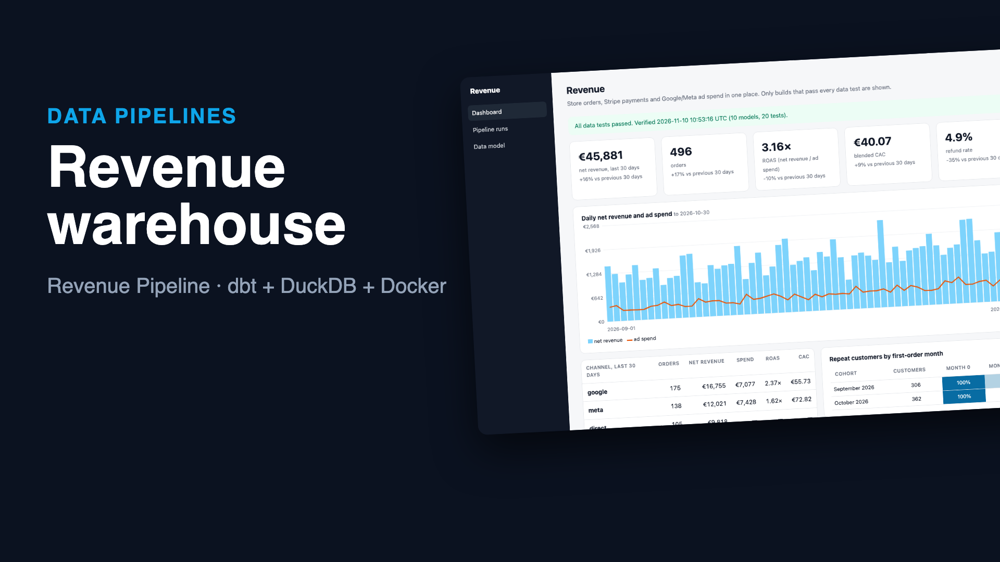
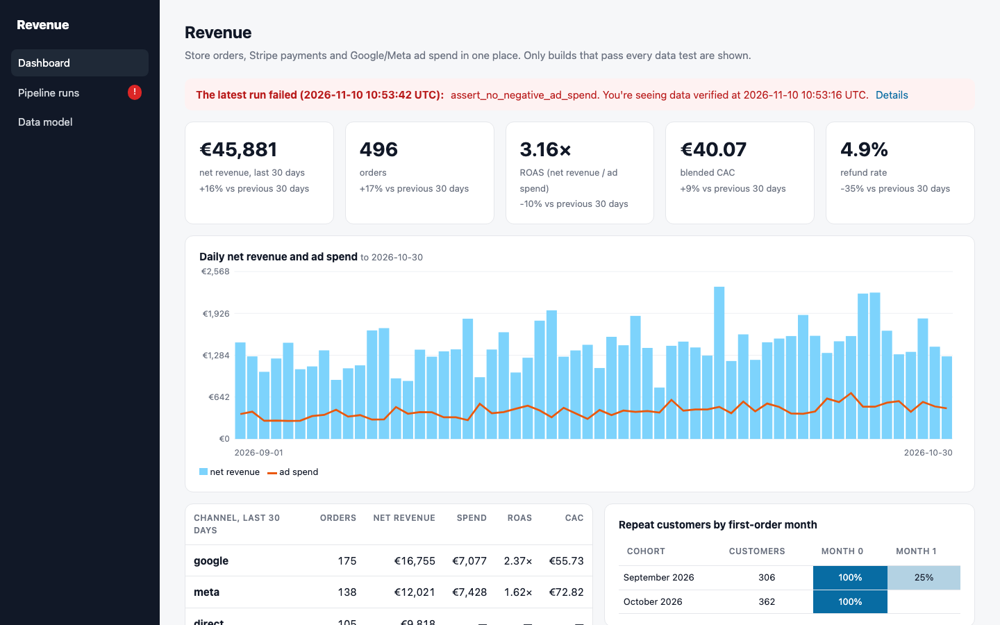

# Revenue Pipeline: revenue numbers you can trust, every morning

The store, the payment processor and the ad platforms each tell part of the story. This pipeline pulls all three every hour: Shopify-style orders, Stripe-style charges and refunds, and Google and Meta ad spend. It builds a DuckDB warehouse with **dbt** and runs 20 data tests. Only a build that passes every test reaches the dashboard: net revenue, ROAS and CAC per channel, refund rate, and repeat customers by cohort.

When something breaks upstream, the run fails loudly. The dashboard keeps showing the last verified numbers and says so. Typical breaks:
- an ad platform sends a negative spend row
- someone renames a column in a CSV export
- an API is down

```
Shopify orders ─┐  incremental pulls,          raw (append-only)   dbt build: staging → intermediate → marts
Stripe charges ─┼─ overlap windows for   ─▶   in DuckDB      ─▶     + 20 data tests (keys, relationships,
Google/Meta ads ┘  late updates, retries                            reconciliation, negative spend, totals)
                                                                         │ all green?
                                                       yes ─▶ atomic copy to serving.duckdb ─▶ dashboard
                                                       no  ─▶ nothing published; dashboard warns, keeps verified data
```

**▶ [Watch the 64-second demo](docs/demo.mp4)**: a real recording of the running stack, made with [`demo/record.py`](demo/record.py) (Playwright) and [`demo/video`](demo/video) (Remotion).

[](docs/demo.mp4)



## Run it

```bash
./setup.sh                      # writes .env with random secrets
docker compose up --build       # dashboard on http://127.0.0.1:8096 (local demo login: finance@example.com / password)
```

The first run starts at once, then every `RUN_EVERY_MINUTES` (60). **Run now** is on the Pipeline runs page.

The `sources` service is a **local stand-in** with the request shapes of the real APIs: Shopify's `updated_at_min` filter and Link-header pagination, Stripe's `created[gte]` filter and `starting_after` pagination with amounts in cents, and each ad platform's own CSV headers. It serves 60 days of deterministic data. Its `/_admin` endpoints inject real-world failures for the tests and the demo. For real use, point `SOURCES_URL` and the tokens at the real APIs.

## The dbt project ([`warehouse/`](warehouse))

| Layer | Models | What happens there |
|---|---|---|
| raw | `shop_orders`, `stripe_charges`, `stripe_refunds`, `ad_spend` | untouched JSON and CSV rows, one per delivery; duplicates expected |
| staging | `stg_orders`, `stg_charges`, `stg_refunds`, `stg_ad_spend` | typed, cents → euros, latest version of each record wins, channel from UTM |
| intermediate | `int_order_payments` | what was actually paid and refunded per order, from the payment processor |
| marts | `fct_orders`, `fct_daily`, `fct_channel_weekly`, `dim_customers`, `fct_cohorts` | what the dashboard reads |

The 20 data tests are:
- unique and not-null keys, accepted currencies and channels, and relationships (every charge belongs to an order, every refund to a charge)
- [`assert_store_and_payments_agree`](warehouse/tests/assert_store_and_payments_agree.sql): store totals reconcile with what Stripe charged
- [`assert_refunds_within_charge`](warehouse/tests/assert_refunds_within_charge.sql)
- [`assert_no_negative_ad_spend`](warehouse/tests/assert_no_negative_ad_spend.sql)
- [`assert_ad_spend_unique`](warehouse/tests/assert_ad_spend_unique.sql): re-loads replace, never add
- [`assert_daily_matches_orders`](warehouse/tests/assert_daily_matches_orders.sql): no join fan-out or dropped days

## Design decisions

- **Publish only what passed.** The dashboard never reads the working warehouse. After a fully green `dbt build`, the warehouse is checkpointed and copied to `serving.duckdb` with an atomic rename. A failed run changes nothing anyone sees, and the banner tells them why.
- **Late data is normal.**
  - Every incremental pull re-reads an overlap window: 2 days for the APIs, 7 for ad platforms, which restate recent days.
  - Raw is append-only, so re-reads create duplicates on purpose; staging keeps the latest version of each record.
  - Refunds are attributed to the order's date. A refund arriving today for a September order corrects September.
- **Ad spend windows are replaced, not appended.** Each re-pull deletes and re-inserts its window in one transaction, and a test checks there are no duplicates.
- **Schema drift stops the source, not the truth.** A CSV whose headers don't match the mapping fails that source with a clear message, for example `missing column(s) ['Cost']`. The run isn't built or published, while the other sources still load.
- **Failures are specific.** Retries happen on 429, 5xx and network errors, not on 4xx. A failing test is reported by name, with its bad-row count. Models downstream of a failure are shown as skipped, not as more failures.
- **Verified against an independent truth.** The e2e test compares the warehouse with totals the stand-in computes straight from its own data: orders, gross, refunds, net, ad spend and customers, to the cent.

## Verified end to end

`./e2e.sh` runs the stack in Docker:

1. The first scheduled run must equal the sources' own totals.
2. A negative spend row must fail the run on `assert_no_negative_ad_spend`. The dashboard warns and keeps the verified numbers.
3. A renamed Google Ads column must stop the run before dbt.
4. A late refund must restate a past day, and the totals must match again.

CI runs it on every push.

```
PASS first run: 60 days from 3 sources, warehouse equals the sources' own totals: {'orders': 921, 'gross': 91099.58, ...}
PASS bad data: negative spend caught by a dbt test, run not published, dashboard warned and kept verified data
PASS schema drift: renamed CSV column stopped the run before dbt, nothing published
PASS late refund: picked up by the overlap window, past day restated, totals match the sources again
```

## Tests

```bash
uv sync && uv run pytest -q      # 8 tests, offline: each one runs real extracts and real dbt builds against the stand-ins
```

**Covered:**
- exact totals and idempotent re-runs
- a late refund restating a past day
- a failed data test never published
- schema drift stopping the run before dbt
- outages retried, then reported
- the CSV header mapping
- the chart
- the dashboard banner following the runs

## Stack

Python 3.12 · dbt-core 1.12 + dbt-duckdb · DuckDB · httpx · FastAPI · Jinja2 · Docker · GitHub Actions
