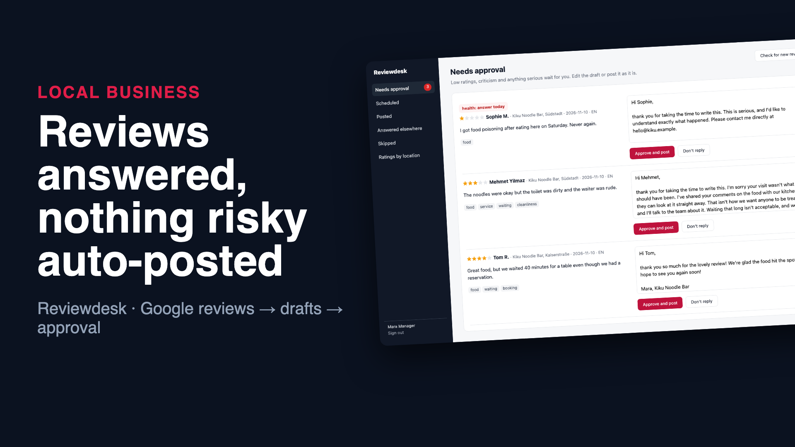
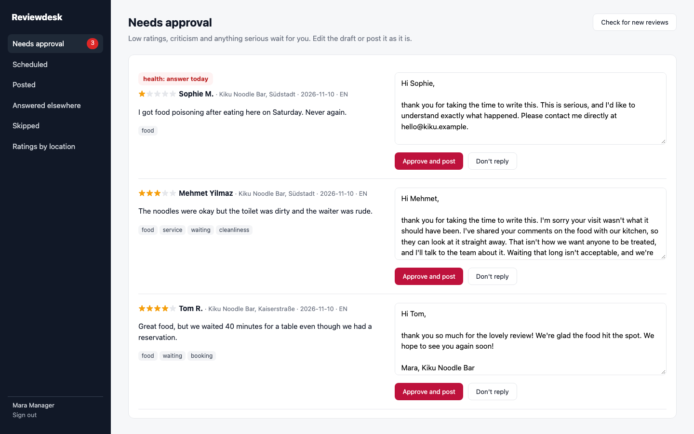
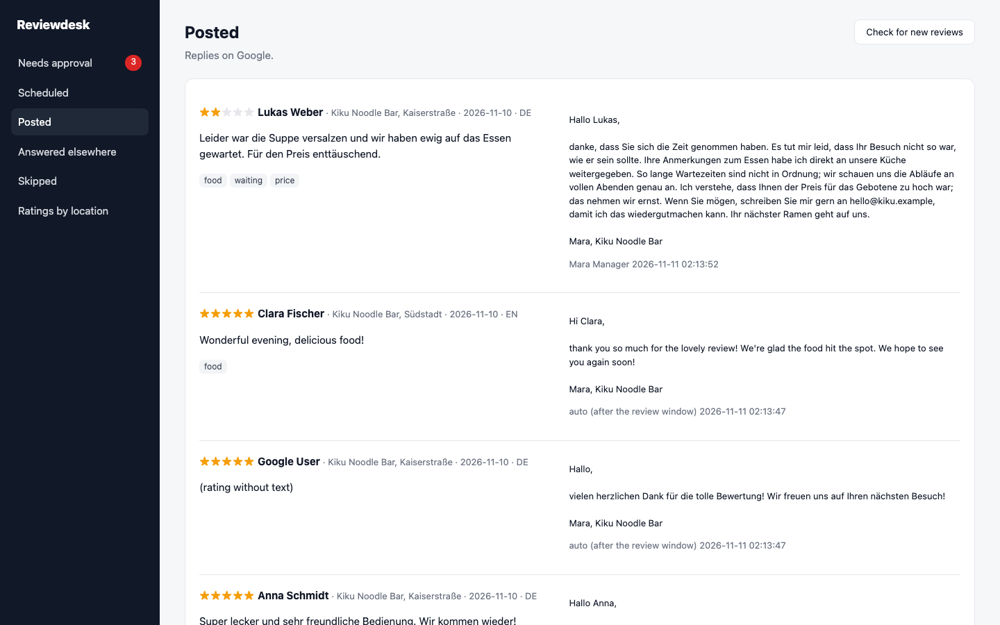

# Reviewdesk: every Google review answered, the hard ones by a person

Restaurants and local shops know they should answer every Google review, and mostly don't. The 5-star ones feel like busywork. The 1-star ones need care and a calm head, so they wait until they're forgotten. A food-poisoning claim left unanswered for a week is the worst case.

Reviewdesk reads new reviews for every location and drafts a reply in the reviewer's language that answers what they actually wrote. It posts the easy ones by itself and puts the rest in front of the manager, with an alert when it's serious.

```
 Google Business Profile (all locations, paged) ─▶ language, topics, serious claims (rules, predictable)
                                                      ─▶ draft from topic phrases, by first name, DE or EN
   5★ / 4★ without "but"  ─▶ scheduled: posts by itself after a review window (anyone can still edit it)
   4★ with "but", 1-3★     ─▶ the manager approves or edits
   1-2★, health, safety, legal ─▶ also a Slack alert; the draft takes it private and never repeats the claim
```

**▶ [Watch the 48-second demo](docs/demo.mp4)**: a real recording of the running stack, made with [`demo/record.py`](demo/record.py) (Playwright) and [`demo/video`](demo/video) (Remotion).

[](docs/demo.mp4)

| What waits for the manager | What was posted |
|---|---|
|  |  |

## Run it

```bash
./setup.sh                      # writes .env with random secrets
docker compose up --build       # panel on http://127.0.0.1:8116 (local demo login: manager@example.com / password)
```

The `apis` service is a **local stand-in** for two services:
- **The Google Business Profile reviews API:** reviews per location with `pageToken` paging, and `PUT …/reviews/{id}/reply`
- **A Slack incoming webhook**

For real use, point `GOOGLE_URL` at `https://mybusiness.googleapis.com` with an OAuth token for the business account, list your locations in `db.py`, and set your Slack webhook.

## How it decides

- **Predictable reading, no model needed.**
  - **Language:** found from common German words and umlauts.
  - **Topics:** keyword patterns in both languages; the topics are food, service, waiting, price, cleanliness and booking.
  - **Serious claims:** health (food poisoning, allergies), safety (glass, insects), legal (lawyers, police). These are found the same way, and the same review always gets the same treatment.
- **Drafts that answer what was written.**
  - **Praise:** thanks and the specific thing they liked.
  - **Criticism:**
    - an apology
    - one concrete sentence per complaint ("I've passed your comments on the food to the kitchen")
    - an invitation to write privately
  - **No promises:** never money, never an argument.
  - **Names:** the first name is used when there is one, never "Google User".
- **Serious claims go private.** For health, safety or legal topics the draft doesn't discuss or repeat the claim in public. It asks the reviewer to get in touch directly, and Slack gets an alert so it's handled today.
- **The policy keeps it safe, not the wording.**
  - Only 5-star reviews, and 4-star reviews without criticism ("but", "leider", "aber"), are posted automatically, and only after a review window (an hour by default) in which anyone can edit or stop them.
  - Everything else waits for a person, most urgent first.
- **Respect for what's already there.**
  - A review someone already answered in the Google app is left alone.
  - A review edited after our reply is logged.
  - A review edited before we replied is re-read and re-drafted.
- **Numbers per location:** average rating, share answered, hours to answer, and the complaint topics of 1-3 star reviews.

## Verified end to end

`./e2e.sh` runs the stack in Docker:

```
PASS sync: 8 reviews on 2 locations; 4 held for approval (the food-poisoning claim first), 2 Slack alerts
PASS auto replies: 4 positive reviews answered after the review window, in English and German, by first name
PASS approval: an edited reply posted from the panel; the food-poisoning draft takes it private and doesn't repeat the claim
PASS respect: a review answered in the Google app was left alone
PASS stats: rating, reply rate, time to answer and complaint topics per location
```

## Tests

```bash
uv sync && uv run pytest -q      # 6 tests
```

**Covered:**
- language, topics, serious claims and names
- drafts for praise, criticism and serious claims
- the policy for every rating, with paging and alerts
- the review window and approvals
- reviews answered elsewhere and edited reviews
- the panel

## Not included yet

- LLM-written drafts. The rule-based drafts are the safe default, and a model would plug in at `drafting.draft` with the same policy around it.
- More languages than German and English
- Other review sites (TripAdvisor, Trustpilot)

## Stack

Python 3.12 · FastAPI · SQLite (WAL) · Google Business Profile API · Slack webhooks · Docker · GitHub Actions
