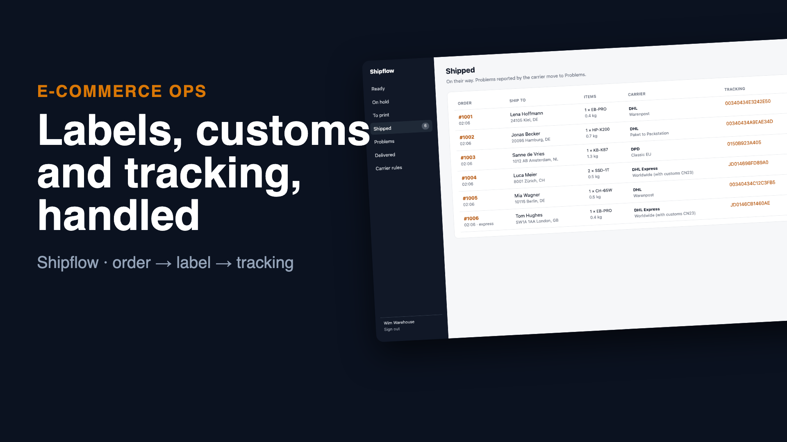
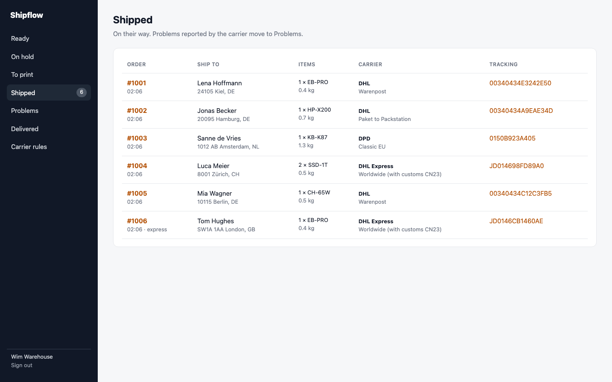
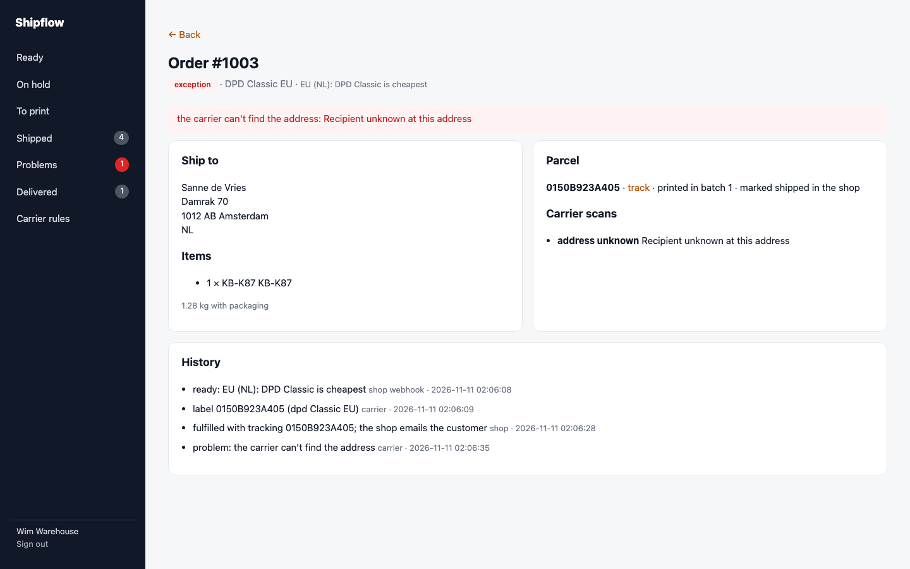

# Shipflow: from paid order to tracked parcel, without the copy-paste

Small shops ship the same way every day. Someone copies each address into the carrier's portal, guesses the cheapest carrier, types customs data for Switzerland, prints labels one by one, and pastes tracking numbers back into the shop. Mistakes show up a week later as returned parcels.

Shipflow does that path from the shop's "paid" webhook, and stops at the right places for a person.

```
 shop: order paid ─ signed webhook ─▶ checks: address, postcode, house number, phone, SKUs, weight, HS codes
                                         │ fails → on hold with the reason (fix in the panel, re-checked)
                                         ▼
                                     carrier rule (with its reason) ─▶ label via the carrier API (once per order)
                                         ▼
 warehouse: "print new labels" ─▶ one PDF ─▶ shop fulfilment with carrier + tracking (shop emails the customer)
 carrier scans (signed webhooks) ─▶ delivered / problems (unknown address, refused, damaged, no scan for 3 days)
```

**▶ [Watch the 50-second demo](docs/demo.mp4)**: a real recording of the running stack, made with [`demo/record.py`](demo/record.py) (Playwright) and [`demo/video`](demo/video) (Remotion).

[](docs/demo.mp4)

| Every order with its carrier and tracking | A problem the carrier reported |
|---|---|
|  |  |

## Run it

```bash
./setup.sh                      # writes .env with random secrets
docker compose up --build       # panel on http://127.0.0.1:8114 (local demo login: warehouse@example.com / password)
```

The `apis` service is a **local stand-in** for two services:
- **A Sendcloud-style multi-carrier API:**
  - parcels with basic auth
  - label PDFs marked "DEMO"
  - a `422` for addresses the carrier can't route
  - status webhooks signed with `Sendcloud-Signature`
- **A Shopify-style shop:** `orders/paid` webhooks and the fulfillments endpoint

For real use, point `CARRIER_URL` and `SHOP_URL` at the real services and map your shipping-method IDs in `flow.py`.

## How it decides

- **Checked before anything is bought.** An order is held, with the reason, for any of these:
  - a missing house number
  - a postcode that isn't valid for its country (DE, AT, CH, NL, FR, BE, IT, ES, PL, GB, US)
  - no phone number for a delivery outside the EU
  - an unknown SKU
  - a parcel over 31.5 kg (freight is booked by hand)
  - a product without an HS code going outside the EU

  The warehouse fixes it in the panel and the order is re-checked.
- **Carrier rules with reasons.** Every order shows the rule that picked its carrier:
  - outside the EU: DHL Express with customs data
  - Packstation addresses: DHL only
  - express paid: DHL Express
  - Germany: DHL Warenpost under 1 kg, Paket above
  - rest of the EU: DPD
- **One label per order.** Before creating a parcel, the carrier is asked for an existing one with the order number. A retry after a timeout reuses it instead of paying for a second label. A carrier refusal (`422`) puts the order on hold with the carrier's message.
- **Customs data from the catalogue.** Description, quantity, weight, value, HS code and country of origin go with every non-EU parcel.
- **The day's labels in one PDF.** "Print new labels" merges every unprinted label, sorted by carrier, into one file. Earlier batches stay downloadable.
- **Shipped means handed over.** A parcel is fulfilled in the shop only after its label was printed. The fulfilment carries the carrier name, tracking number and link, so the shop emails the customer.
- **Problems come to you.** Carrier scans arrive as signed webhooks, de-duplicated by event ID. These move the order to Problems with the carrier's note:
  - unknown address
  - refused
  - damaged
  - returned to sender
  - no scan for 3 days after shipping

## Verified end to end

`./e2e.sh` runs the stack in Docker; orders and scans come in as signed webhooks:

```
PASS rules: DHL Warenpost, DHL to a Packstation, DPD in the EU, DHL Express with customs for Switzerland, express for the UK; a missing house number held
PASS hold fixed: the house number added in the panel, the order re-checked and labelled
PASS batch: 6 labels printed as one PDF; each order fulfilled in the shop with its carrier and tracking number
PASS tracking: carrier scans delivered one parcel and flagged one with an unknown recipient
PASS webhooks: forged shop and carrier webhooks refused
```

## Tests

```bash
uv sync && uv run pytest -q      # 6 tests
```

**Covered:**
- every carrier rule
- every hold reason and the fix
- customs data
- carrier refusals
- label reuse after a lost answer
- the merged PDF
- fulfilment only after printing
- tracking events, duplicates and stuck parcels
- webhook signatures
- the panel

## Not included yet

- Return labels and a returns portal
- Multi-parcel orders (one parcel per order today)
- Live rate shopping across carriers; the rules pick by country, weight and service

## Stack

Python 3.12 · FastAPI · SQLite (WAL) · pypdf · fpdf2 · httpx · Docker · GitHub Actions
