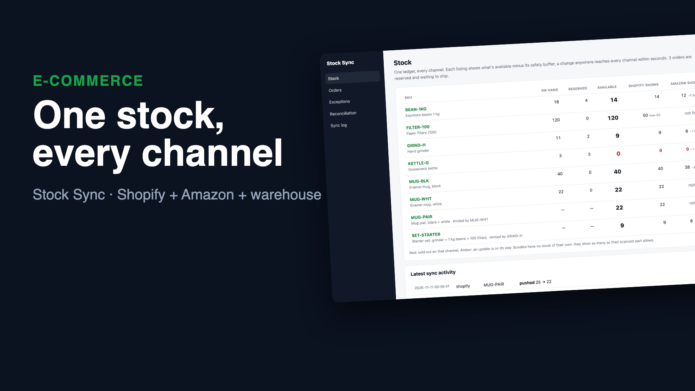
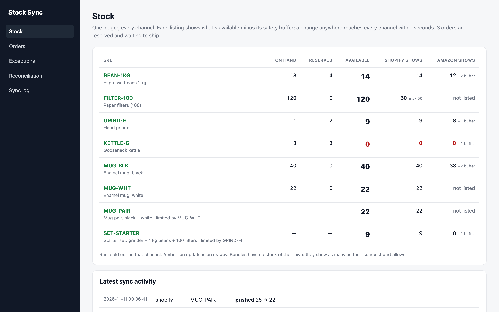
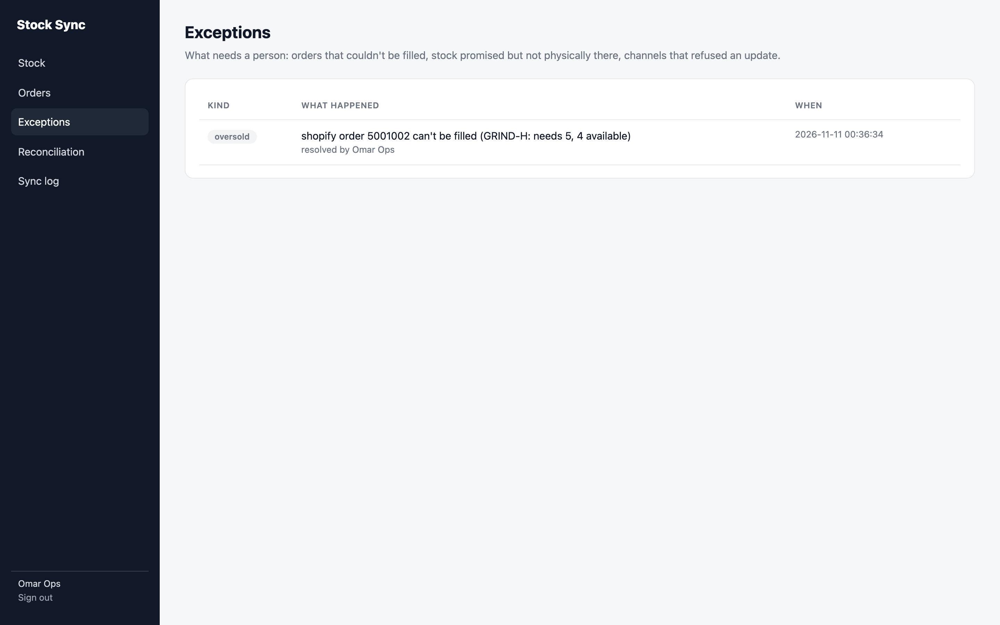

# Stock Sync: sell the same stock on Shopify and Amazon without overselling

When the same 3 kettles are listed on Shopify and Amazon, the classic failure is both channels selling the last one. The usual fixes are a nightly CSV or a manual spreadsheet, and neither is fast enough. Stock Sync keeps **one stock ledger** that the shop, the marketplace and the warehouse all write to, and pushes the right quantity to every channel within about a second of any change.

```
 Shopify ── orders/create, orders/cancelled (signed webhooks) ─┐                 ┌─▶ Shopify inventory_levels/set
 Amazon ─── getOrders polling (LastUpdatedAfter, NextToken) ───┼─▶  stock ledger ─┤   (available − buffer, capped)
 Warehouse ─ receipts, shipments (signed webhooks) ────────────┘    reserve /     └─▶ Amazon Listings PATCH
            stock count (snapshot API) ── reconciliation ─────▶     release /         fulfillment_availability
                                                                    ship / adjust
```

**▶ [Watch the 55-second demo](docs/demo.mp4)**: a real recording of the running stack, made with [`demo/record.py`](demo/record.py) (Playwright) and [`demo/video`](demo/video) (Remotion).

[](docs/demo.mp4)

| Every channel from one ledger | An oversell caught, with the fix one click away |
|---|---|
|  |  |

## Run it

```bash
./setup.sh                      # writes .env with random secrets
docker compose up --build       # panel on http://127.0.0.1:8102 (local demo login: ops@example.com / password)
```

The `apis` service is a **local stand-in** for Shopify's Admin REST API, Amazon's SP-API (Listings Items and Orders) and a warehouse system, with their real request shapes. Like a real storefront, it refuses to sell what it shows as sold out. That's what makes overselling testable. For real use, point `SHOPIFY_URL`, `AMAZON_URL` and `WMS_URL` at the real services (the Amazon token comes from Login with Amazon).

## How it works

- **A ledger, not a counter.** Every change is a movement (`receipt`, `reserve`, `release`, `ship`, `adjust`) with a reference and the stock level after it, so you can always answer "why does it say 9?". The `(kind, sku, ref)` key is unique, so a webhook delivered twice or an order polled twice books once.
- **Orders reserve everything or nothing.**
  - A basket that can't be filled completely is marked *oversold* and raised as an exception that names the shortfall, for example `GRIND-H: needs 5, 4 available`.
  - Nothing is half-reserved.
  - After new stock arrives, **Try to reserve again** books it.
  - Ten parallel orders for the last 3 kettles: exactly 3 are reserved.
- **Bundles have no stock of their own.** A starter set (grinder, beans, filters) is available as often as its scarcest part. Selling one reserves the parts, and every bundle that shares a part updates with it.
- **Each channel sees its own number:** available minus a safety buffer (Amazon is slower to stop selling, so it gets one), optionally capped ("show at most 50"). Sell-outs are pushed first.
- **Only changes are pushed.** The worker compares each listing's target with the last quantity it pushed and sends only the differences.
  - A Shopify sale of the last kettles reached Amazon as 0 in **0.8 s** in the end-to-end test.
  - A `429` pauses that channel for its `Retry-After` while the others keep going.
  - A refused update becomes an exception, not a silent failure.
- **Reconciliation.**
  - **Stock count:** the warehouse count is compared with the ledger. A difference is booked only when it shows up **in two runs in a row**, so a shipment whose webhook is still in flight doesn't look like missing stock.
  - **Channel drift:** each channel's displayed quantity is compared with what was pushed. A quantity someone edited by hand in Shopify is found and overwritten.
- **Stock goes short:** when units promised to open orders are found broken (an adjustment below the reserved amount), a *short* exception is raised.
- **Webhooks are verified:** Shopify's base64 HMAC, the warehouse's hex HMAC. Shopify webhooks are de-duplicated by `X-Shopify-Webhook-Id`. Manual adjustments need a reason; it goes into the ledger with the person's name.

## Verified end to end

`./e2e.sh` runs the stack in Docker:

```
PASS first sync: 13 listings pushed; Amazon keeps its safety buffer, filters capped at 50, bundles follow their scarcest part
PASS sell-out: last 3 kettles sold on Shopify, Amazon showed 0 after 0.8s and refused the next buyer
PASS oversell: a late Shopify webhook found the stock sold on Amazon, raised an exception, reserved after the goods receipt; bundles followed
PASS shipping: the warehouse shipment turned the reservation into a stock decrease, availability unchanged
PASS throttling: Amazon answered 429 three times, the worker backed off and caught up
PASS reconciliation: a count difference booked only after showing twice, a hand-edited Shopify quantity re-pushed
PASS security: forged warehouse webhook refused, stock unchanged
```

## Tests

```bash
uv sync && uv run pytest -q      # 8 tests
```

**Covered:**
- bundles, buffers and caps
- all-or-nothing and idempotent orders
- a 10-way race for the last units
- ship, cancel and duplicate receipts
- change-only pushes under throttling
- Amazon order pagination and cancellations
- both kinds of reconciliation
- webhook signatures and duplicates
- the panel

## Not included yet

- Multiple warehouses or locations (one location per channel today)
- Returns and restocking flows; a return is booked as a receipt for now
- Amazon FBA stock, which Amazon holds itself. This handles merchant-fulfilled listings.

## Stack

Python 3.12 · FastAPI · SQLite (WAL) · httpx · Jinja2 · Docker · GitHub Actions
