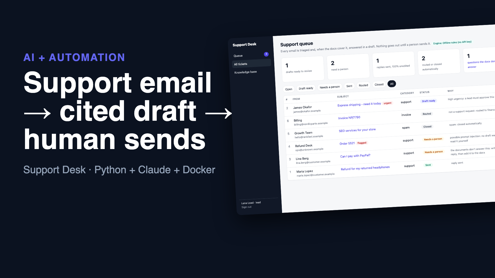
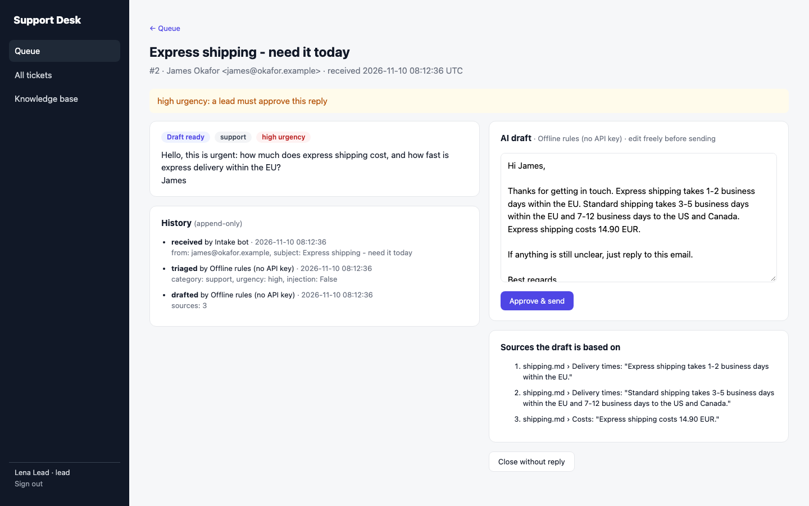

# Support Desk: AI drafts, human approval, one `docker compose up`

A support inbox that answers itself, but only with a person's OK. Customer emails arrive over IMAP and are triaged. When the company's own documents cover the question, a reply is drafted with the source of every fact. An agent reviews the draft, edits it if needed, and sends it as a threaded reply. Anything risky waits for a person:
- prompt-injection attempts
- urgent emails
- questions the docs can't answer

```
customer email ──▶ IMAP inbox ──▶ worker: triage ──▶ retrieve from docs ──▶ cited draft ──▶ panel: agent/lead approves ──▶ SMTP reply
                                   (Claude or offline)   (BM25, sections)                    roles, audit trail          (In-Reply-To)
```

**▶ [Watch the 1-minute demo](docs/demo.mp4)**: a real recording of the running stack, made with [`demo/record.py`](demo/record.py) (Playwright) and [`demo/video`](demo/video) (Remotion).

[](docs/demo.mp4)



## Run it

```bash
./setup.sh                      # writes .env with random secrets
docker compose up --build       # web panel on http://127.0.0.1:8090, test mail server on 3025/3143
```

- **Sign in (local demo accounts, password `password`):**
  - `agent@example.com` sends normal replies
  - `lead@example.com` can also send urgent and flagged replies
  - `viewer@example.com` can only read
- **Send test mail:** `python3 -c "import smtplib,pathlib; s=smtplib.SMTP('127.0.0.1',3025); [s.sendmail('c@example.com',['support@shop.example'],p.read_bytes()) for p in sorted(pathlib.Path('samples').glob('*.eml'))]"`
- **Draft with Claude:** add `ANTHROPIC_API_KEY=...` to `.env`. Without it, the offline engine runs: rule-based triage plus extractive drafts that quote the docs verbatim. It is deterministic and free, and it is what the demo and CI use.
- **Use your own docs:** set `KB_PATH=/path/to/markdown-folder`. **Use a real mailbox:** point `IMAP_*` and `SMTP_*` at it (SSL and STARTTLS are the defaults).

## What happens to each email

| Email | Result |
|---|---|
| Question the docs answer | **Draft ready**, with numbered sources an agent can check |
| Same, but urgent ("today", "asap", "chargeback"…) | Draft ready, but **only a lead can send it** |
| Question the docs don't answer | **Needs a person**, and added to the knowledge-gap list ("what to write next") |
| Prompt injection ("ignore previous instructions…") | **Needs a person**, flagged; **no AI draft is ever written** |
| Spam | Closed automatically (visible under Closed) |
| Invoice, sales lead, partnership | Routed to that team (`finance`, `sales`) |

## Design decisions

- **Human in the loop by construction.** The worker has no SMTP access path: only the panel's "Approve & send" sends, after a role check.
- **Grounded or silent.**
  - Drafts use only retrieved sections of your docs, and every claim lists its source.
  - With Claude, document text goes in as citable `document` blocks, and the customer's email is marked as untrusted data.
  - When retrieval finds nothing relevant, no draft is written, so nothing is made up.
- **Prompt-injection aware.** Suspected injections skip drafting entirely: the model never writes a reply an attacker steered.
- **No loss, no duplicates.**
  - Mail is read with `BODY.PEEK` and marked seen only after the ticket is stored.
  - API outages or rate limits leave it unread for the next pass.
  - Message-ID makes re-processing a no-op.
- **Exactly-once send.** The ticket is claimed (`status → sent`) in the same transaction as the SMTP send. A double click or a second agent gets 409/403. An SMTP failure rolls back, so the ticket stays open.
- **Accountability.** An append-only history (enforced by SQLite triggers) records who triaged, drafted, edited and sent. The dashboard shows the share of replies sent unedited, which tells you how good the drafts are.
- **Web basics done properly.** Sessions are signed with SameSite=strict cookies and every form has a CSRF token. Passwords are hashed with scrypt, and the container runs as non-root.

## Reuses the rest of the portfolio

Triage is [`email-triage`](../email-triage) (Claude structured outputs, injection flag, routing table). Retrieval and citation requests are [`doc-qa`](../doc-qa) (BM25 over markdown sections, Claude citations). Both are installed here as path dependencies, so there is one implementation of each.

## Verified end to end

`./e2e.sh` starts the stack, emails the 6 samples, and checks the status of every ticket. It then signs in as an agent over HTTP, sends the refund draft, and reads the reply from the customer's own mailbox over IMAP, checking `Re:` and `In-Reply-To`. It also confirms that an agent can't send the urgent reply. CI runs it on every push.

```
PASS: 2 drafted, 2 held for a person (unanswered + injection), spam closed, invoice routed; reply delivered in thread
```

## Tests

```bash
uv sync && uv run pytest -q      # 12 tests, offline
```

**Worker tests:**
- routing of all 6 sample emails
- injection gets no draft
- quoted sources really are in the docs
- duplicate mail is a no-op
- an outage leaves mail unread for retry
- Claude request shape: citable docs, injection-safe system prompt

**Panel tests:**
- login and wrong password
- agent send produces a threaded reply and an audit entry
- a second send is refused
- urgent and flagged emails need a lead
- the lead's edit is recorded
- viewer is read-only
- CSRF is enforced
- an SMTP failure keeps the ticket open
- queue filters and the knowledge-gap page

## Stack

Python 3.12 · FastAPI · Jinja2 · SQLite (WAL) · Claude API (structured outputs, citations) · GreenMail (test SMTP/IMAP) · Docker Compose · GitHub Actions
