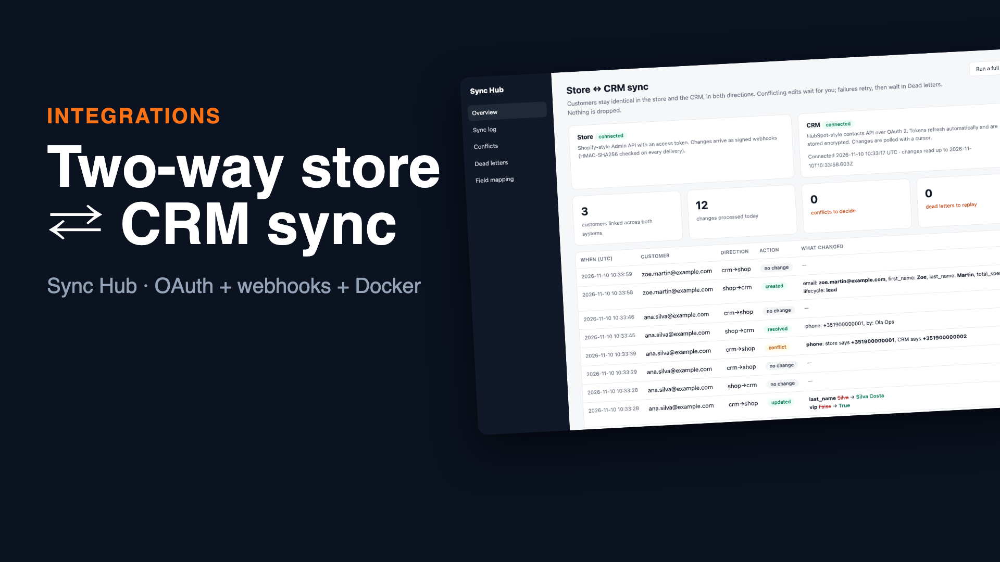
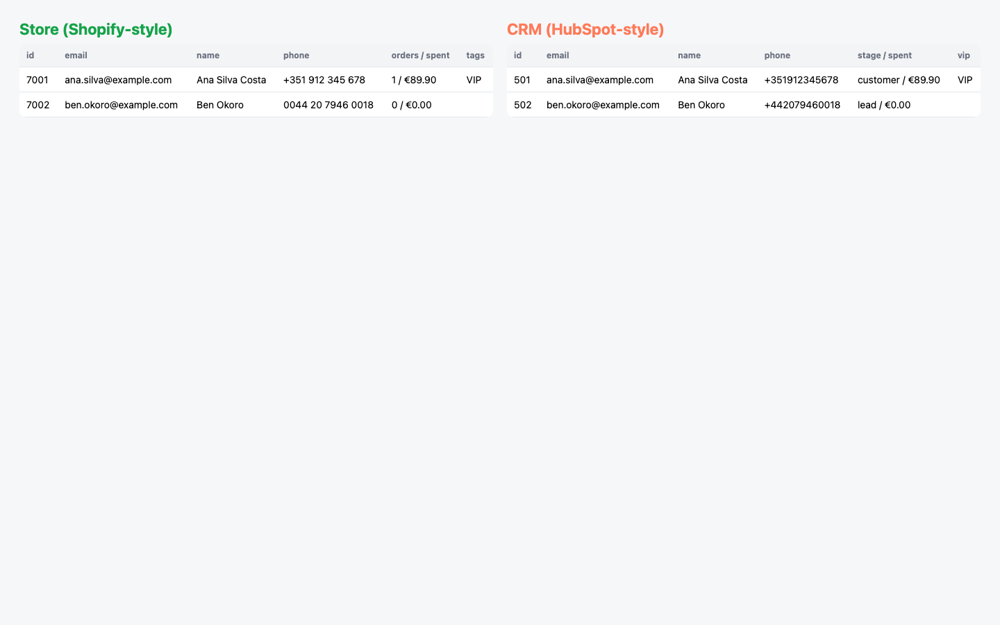

# Sync Hub: your store and your CRM, kept in sync both ways

Customers live in two places: the online store (Shopify-style) and the sales team's CRM (HubSpot-style). This hub keeps them identical in both directions.

- **Store → CRM:** a new store signup appears in the CRM, and order totals follow.
- **CRM → store:** a sales rep's edit reaches the store, and a VIP flag set in the CRM tags the customer in the store.

It handles what makes real integrations hard:
- OAuth with expiring tokens
- signed webhooks
- edits on both sides at once
- conflicting edits
- its own writes echoing back
- outages and rate limits

```
store ──signed webhooks (HMAC)──▶ ┐                                   ┌──▶ CRM   (OAuth 2, auto-refresh, encrypted tokens)
                                  ├─▶ event queue ─▶ sync engine ─▶ ──┤
CRM ──polling with a cursor─────▶ ┘    dedupe,       mapping, echo    └──▶ store (access token)
                                       per-record    suppression,
                                       ordering      read-before-write conflict check
                          failures: retry with backoff / Retry-After ─▶ dead letters ─▶ replay from the panel
```

**▶ [Watch the 68-second demo](docs/demo.mp4)**: a real recording of the running stack, made with [`demo/record.py`](demo/record.py) (Playwright) and [`demo/video`](demo/video) (Remotion).

[](docs/demo.mp4)



## Run it

```bash
./setup.sh                      # writes .env with random secrets
docker compose up --build       # panel on http://127.0.0.1:8094 (local demo login: ops@example.com / password)
```

Press **Connect CRM** and allow access on the consent screen. Then change customers on either side through the stand-ins' admin endpoints; `e2e.sh` shows each call. `http://127.0.0.1:8095/_view?token=$FAKES_ADMIN_TOKEN` shows both systems side by side.

The `apis` service is a **local stand-in** for the two systems, with the request shapes of HubSpot's contacts API and Shopify's Admin API: OAuth consent and token endpoints, rotating refresh tokens, HMAC-signed webhooks, 429s and outages on demand. The demo and tests never touch a real account. For real use, point `CRM_URL` / `SHOP_URL` at the real APIs with your app's credentials, register the webhook URL in the store, and remove `apis`.

## Field mapping

| Field | Direction | Why |
|---|---|---|
| email | store ⇄ CRM | match key |
| first name, last name | store ⇄ CRM | |
| phone | store ⇄ CRM | normalised to `+digits` |
| total spent | store → CRM | the store is the source of truth for money |
| lifecycle stage | store → CRM | `customer` once they've ordered, otherwise `lead` |
| VIP | CRM → store | sales marks VIPs in the CRM; the store gets a `VIP` tag |

## Design decisions

- **Snapshots per side, per customer.** For every linked pair the hub keeps both sides' values as of the last sync. Three things follow from that:
  - **No echo loops.** The hub's own write coming back as a webhook or poll result matches the snapshot and is logged as "no change". The e2e test checks that the write counters stay still over several poll cycles.
  - **Only changed fields are written,** never a full overwrite.
  - **Conflicts go to a person.** Before writing, the hub reads the target. If the same field also changed there since the last sync, to a different value, neither side is overwritten. The conflict waits in the panel, and the chosen value is written to the other side.
- **Edits on both sides at once aren't lost.** After a write, the target's snapshot advances only for the fields that were written. Its own pending edits in other fields stay visible for its own event. The recording caught the first version getting this wrong: a CRM edit was swallowed when a store order synced first. [`test_concurrent_edits_on_both_sides_are_not_lost`](tests/test_hub.py) now guards it, and the e2e test runs the same scenario.
- **Always act on current state.** Webhooks can be retried or arrive out of order, so the hub re-reads the record instead of trusting the payload.
- **Events processed in order:**
  - Events are de-duplicated by webhook id or poll version.
  - They're processed oldest first, one at a time per customer. A later change waits behind an earlier one that is retrying; other customers keep flowing.
  - The CRM cursor only moves forward after the events are safely queued.
- **Failures are classified once,** in the API clients:
  - 429s wait as long as `Retry-After` says.
  - 5xx and network errors back off exponentially.
  - Other 4xx are permanent.
  - An expired access token is refreshed once, transparently.
  - After the retry budget, an event becomes a dead letter with its error. Nothing is dropped; replay it after fixing the cause.
- **Security:**
  - Webhooks are rejected without a valid HMAC-SHA256 signature (constant-time compare).
  - The OAuth `state` is checked.
  - Access and refresh tokens are encrypted at rest with Fernet, with the key from the environment.
  - Sessions are signed, every form has a CSRF token, passwords are hashed with scrypt, and containers run as non-root.

## Verified end to end

`./e2e.sh` runs the whole stack in Docker and checks each path:
- OAuth through the panel
- a store signup reaching the CRM
- a CRM edit and a store order at the same moment, both arriving
- one-way fields respected
- no loops over several poll cycles
- a conflict resolved from the panel
- an outage ending in a dead letter that's replayed
- a forged webhook rejected
- an expired token refreshed without losing the change

CI runs it on every push.

```
PASS oauth: consent screen, code exchange, tokens stored
PASS two-way: store->CRM create, simultaneous CRM edit + store order both arrive, one-way fields respected
PASS no loops: write counters stable over 4 s of polling
PASS conflict: neither side overwritten, store value kept from the panel
PASS outage: retried, parked as a dead letter, replayed from the panel
PASS security: forged webhook rejected, expired token refreshed without losing the change
```

## Tests

```bash
uv sync && uv run pytest -q      # 14 tests, offline, against the stand-ins in-process
```

**Covered:**
- tokens encrypted at rest
- create and echo suppression
- CRM to store edits with a field-level log
- one-way fields
- conflict detection and resolution
- outage → dead letter → replay
- `Retry-After` honoured
- transparent token refresh
- per-customer ordering and duplicate deliveries
- permanent failures
- phone normalisation
- concurrent edits not lost
- webhook signatures and duplicates
- OAuth connect through the panel, including a state mismatch

## Stack

Python 3.12 · httpx · FastAPI · Jinja2 · SQLite (WAL) · cryptography (Fernet) · OAuth 2 · HMAC webhooks · Docker · GitHub Actions
