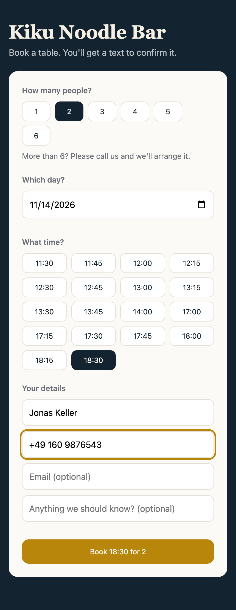
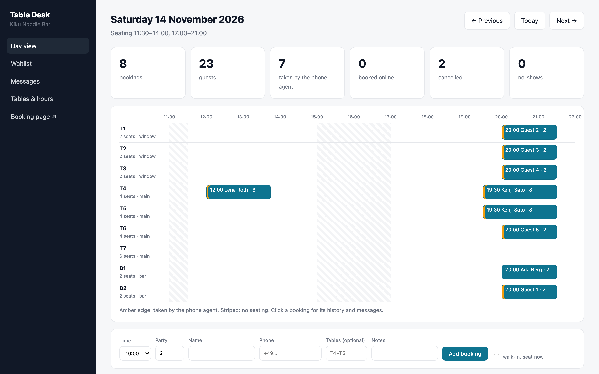
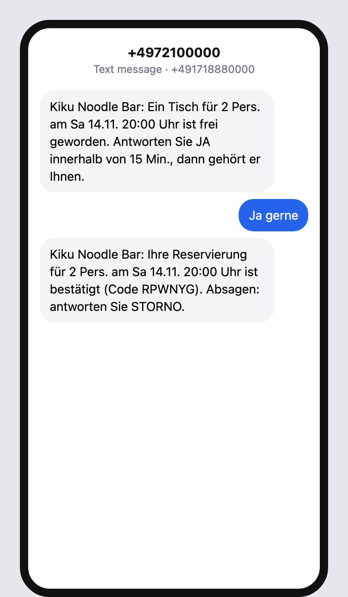

# Table Desk: every reservation, from every channel, in one book

Restaurants lose bookings in the gaps between channels. The phone rings during the rush, someone writes the booking on paper, the website tool doesn't know about it, and two parties end up promised the same table. Table Desk is one reservation book that every channel writes to through the same rules:

- **an AI phone agent** (Retell, Vapi or a similar voice platform) checks availability, books, finds, cancels, puts guests on the waitlist and takes messages through six tool webhooks
- **a booking page** guests use on their phone
- **SMS**: confirmation, a reminder the day before, and replies the system understands: `STORNO`/`CANCEL` cancels, `JA`/`YES` takes a waitlist offer
- **the staff panel**: a floor timeline of the day, walk-ins, no-shows, the waitlist and the messages that need a person

```
 phone agent ─ tool webhooks ─┐                                        ┌─ SMS out (Twilio API): confirmation,
 booking page ─ JSON API ─────┤                                        │  reminder, cancellation, waitlist offer
 guest SMS ─ signed webhook ──┼─▶ engine: one transaction per booking ─┤
 staff panel ─ forms ─────────┘   (hours, stay length, table joins,    └─ panel: day timeline, waitlist, inbox
                                   waitlist, retention)
```

| Website booking | Day view for the staff | The guest's phone |
|---|---|---|
|  |  |  |

## Run it

```bash
./setup.sh                      # writes .env with random secrets
docker compose up --build       # booking page http://127.0.0.1:8098 , staff panel /panel (local demo login: host@example.com / password)
```

The `sms` service is a **local stand-in** with Twilio's request shapes: the Messages REST endpoint with basic auth, and inbound texts delivered as form posts signed with `X-Twilio-Signature`. `http://127.0.0.1:8099/phone/<number>?token=<FAKES_ADMIN_TOKEN>` shows one guest's conversation as a phone screen. For real use, point `SMS_API_URL` at `https://api.twilio.com`, set the account SID, token and sender, and set the number's webhook to `<PUBLIC_URL>/webhooks/sms`.

The phone agent is configured on the voice platform: each tool is a custom function that POSTs `{"args": {...}, "call": {"call_id": ..., "from_number": ...}}` to `/agent/<tool>` with `Authorization: Bearer <AGENT_TOOL_TOKEN>`. Every answer carries a `result` sentence the agent can say as is.

## How it decides

- **Tables are allocated when the booking is made.**
  - A party gets the smallest table that fits.
  - If none is free, it gets the smallest allowed join of neighbouring tables (T1+T2, T4+T5, …).
  - Automatic allocation never puts a party on a table more than two seats too big. Staff can override that by naming the tables.
  - Bar seats are never offered on the website.
- **No double bookings, even under load.** The availability check and the insert run in one `begin immediate` transaction. A test fires 16 parallel bookings of 6 at the same time: exactly three get tables, and no table is held twice.
- **Stay length depends on the party:** 90 minutes up to 2 people, 105 up to 4, 120 above that. A table is free again when the stay ends. Last seating is one hour before closing.
- **Retries never book twice.** Voice platforms retry a tool call when it times out. The same `call_id` with the same arguments returns the stored answer.
- **The waitlist can't promise a table twice.**
  - When a table frees up (a cancellation, a no-show, a party leaving early), the first guest whose time window fits gets a text and 15 minutes to answer `JA`.
  - Only one offer per day is live at a time.
  - If staff give the table away in the meantime, the guest is told and stays on the list. An unanswered offer moves to the next guest.
- **Free text is never answered by a guess.** "Can we come 30 minutes later?" lands in the staff inbox. Only the cancel and yes keywords are handled automatically, and a redelivered webhook is ignored by its message ID.
- **Messages survive outages.**
  - The worker claims each message before sending it, so it's sent once.
  - It retries 429, 5xx and network errors with backoff.
  - A message the gateway refuses (for example an invalid number) fails at once and shows in the panel with a Retry button.
  - Reminders and unsent messages are dropped when a booking is cancelled.
- **Guests' data is kept only as long as needed.** Names, numbers and texts are removed 30 days after the visit; statistics stay.
- **Abuse limits on the public page:**
  - a honeypot field
  - 5 bookings per hour per connection
  - 3 open bookings per phone number
  - a 4 KB body cap
  - parties over 6 are sent to the phone
  - cancelling online needs the last digits of the booking's phone number, not just the code

## Verified end to end

`./e2e.sh` runs the stack in Docker and checks, against the real HTTP surfaces:

```
PASS website: booked VFMEKQ, number normalised to +49, confirmation text delivered
PASS phone agent: party of 8 booked by voice tools, retried call returned the same booking WX3NX7
PASS sms cancel: STORNO reply cancelled the booking and confirmed it
PASS waitlist: fully booked at 20:00, a cancellation was offered by text, JA reply booked it
PASS outage: two 503s from the SMS gateway, confirmation delivered on retry
PASS webhook: forged X-Twilio-Signature refused, booking untouched
PASS panel: day view shows the phone, website and waitlist bookings with their status
```

## Tests

```bash
uv sync && uv run pytest -q      # 14 tests
```

**Covered:**
- allocation and table joins
- stays ending
- parallel bookings
- every invalid request and its explanation
- message scheduling and cancellation
- SMS keywords and duplicate deliveries
- the waitlist race and offer expiry
- worker retries and permanent failures
- data retention
- all six agent tools, including retries and missing details
- webhook signatures
- the booking page with its honeypot, rate limit and cancel check
- the staff panel

## Not included yet

- Deposits or card guarantees for no-shows (Stripe SetupIntent would fit here)
- Editing hours and tables in the panel (they're seeded in `db.py` and shown read-only)
- A real voice-agent recording: the e2e test calls the tool webhooks exactly as the platform does, but no phone call is in this repo

## Stack

Python 3.12 · FastAPI · SQLite (WAL) · Jinja2 · httpx · Docker · GitHub Actions
